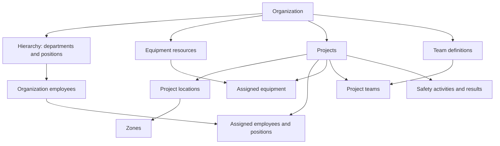
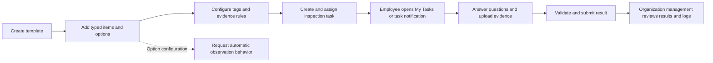
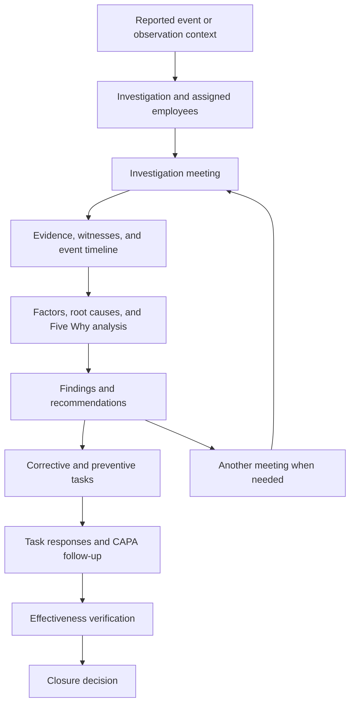
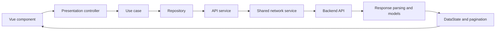

# HSE System — Features, Business Workflows, and Engineering Showcase

> A repository-based overview for portfolio presentations, technical interviews, client demonstrations, and architecture discussions.
>
> Reviewed on 8 October 2026. This document describes the frontend implementation and its backend integration contracts. Source inventory and endpoint definitions were scanned across the project, with focused implementation review of the major workflows. It does not certify backend behavior, production usage, regulatory compliance, or personal authorship of every file.

## Contents

1. [Product overview](#1-product-overview)
2. [Three workspaces](#2-three-workspaces)
3. [Organization structure and project relationships](#3-organization-structure-and-project-relationships)
4. [Lookups and preset data](#4-lookups-and-preset-data)
5. [Project setup and operational hub](#5-project-setup-and-operational-hub)
6. [Flagship feature: dynamic inspections](#6-flagship-feature-dynamic-inspections)
7. [Audits and internal audit planning](#7-audits-and-internal-audit-planning)
8. [Observations, hazards, and incidents](#8-observations-hazards-and-incidents)
9. [Flagship feature: investigations](#9-flagship-feature-investigations)
10. [Flagship feature: CAPA and effectiveness verification](#10-flagship-feature-capa-and-effectiveness-verification)
11. [Permit to work](#11-permit-to-work)
12. [Risk assessment](#12-risk-assessment)
13. [PPE matrix and employee delivery](#13-ppe-matrix-and-employee-delivery)
14. [Induction and safety education](#14-induction-and-safety-education)
15. [Meetings and follow-up actions](#15-meetings-and-follow-up-actions)
16. [Management of change](#16-management-of-change)
17. [Drills, leadership, and objectives](#17-drills-leadership-and-objectives)
18. [Notifications and employee task navigation](#18-notifications-and-employee-task-navigation)
19. [Additional platform features](#19-additional-platform-features)
20. [Architecture and code organization](#20-architecture-and-code-organization)
21. [UI, localization, identity, and documents](#21-ui-localization-identity-and-documents)
22. [Quality and delivery tooling](#22-quality-and-delivery-tooling)
23. [Skills demonstrated by the implementation](#23-skills-demonstrated-by-the-implementation)
24. [Portfolio presentation and demo](#24-portfolio-presentation-and-demo)
25. [Implementation boundaries](#25-implementation-boundaries)
26. [Source evidence map](#26-source-evidence-map)
27. [Complete endpoint registry](#27-complete-endpoint-registry)
28. [Feature directory inventory](#28-feature-directory-inventory)
29. [Route module inventory](#29-route-module-inventory)

## 1. Product overview

HSE System is a web application for managing Health, Safety, and Environment operations across organizations and projects. It combines workforce structure, equipment resources, configurable safety forms, assigned employee tasks, incident reporting, investigations, and follow-up actions.

Its central business relationship is:

**Organization → projects and resources → safety activities → assigned employees → submitted evidence and results → management review and follow-up.**

The application connects modules that would otherwise be separate spreadsheets or disconnected forms. An equipment record can be assigned to a project, inspected using a reusable template, and reviewed through its inspection result. An observation can supply context for an investigation whose findings lead to corrective and preventive tasks.

The most substantial features to demonstrate are:

| Feature | Why it is a strong showcase |
| --- | --- |
| Dynamic inspections | Configurable question types, conditional evidence, assignment, scheduling, employee answers, and result review |
| Investigations | Witnesses, evidence, root causes, Five Why questions, event timelines, meetings, and action plans |
| CAPA | Separate corrective and preventive work, task progress, ownership, and effectiveness verification |
| Project setup | A guided sequence connecting locations, positions, employees, teams, equipment, and holidays |
| PPE matrix | Activity-to-tool configuration plus employee-specific delivery records |
| Notifications | Real-time delivery, persisted notification retrieval, unread state, and navigation into operational work |
| Layered architecture | Repeatable feature structure, typed contracts, reusable state handling, and centralized network integration |

## 2. Three workspaces

### Administrator panel

The administration workspace supports platform configuration and organization management. Its route modules cover administrators, organizations, industries, languages, project types, catalogs, subscriptions, subscription applications, subscription types, and website content.

Shared configuration routes also expose reusable business definitions such as templates, equipment types, hazard types, roles, teams, certificates, and permit types where configured for the workspace.

The administrator experience demonstrates management of a platform serving multiple organizations. The frontend selects a dashboard API prefix for administrator accounts; server-side organization isolation must be assessed in the backend separately.

### Organization panel

The organization workspace supports daily operations: employees, hierarchy, locations, projects, equipment, inspections, observations, hazards, incidents, investigations, CAPA, internal audit plans, change management, and reporting.

Managers configure resources and safety tasks, while employees use their assignments and reporting screens. Result review belongs to the organization management experience for operational records. Avoid describing every inspection result as a global administrator dashboard feature: the concrete inspection routes are organization routes.

### Employee interface

The dedicated landing page is `/organization/employee-interface`. Authentication routing sends employee accounts to this page when they enter the application root or workspace root.

The current employee cards explicitly provide:

- Daily inspection tasks.
- Inspection logs.
- Add and view observations.
- Report and view incidents.

Some creation/task buttons depend on the employee having available projects. This reflects an operational prerequisite: project-related work needs project context.

Other modules, including permits, are accessed through project pages and relevant notification links. The employee landing page does not currently contain cards for every HSE module.

**Code evidence:** [EmployeeInterfaceCard.vue](src/features/EmployeeInterface/Presentation/supcomponents/Card/EmployeeInterfaceCard.vue), [guards.ts](src/router/guards.ts).

## 3. Organization structure and project relationships

An organization manages employees, equipment, locations, teams, and a hierarchy. Departments and positions should be explained through the implemented hierarchy model: nodes can reference a parent, and project setup contains a positions step. There is no need to claim a separate department feature directory or a database schema that is absent from this frontend repository.



This is a conceptual map inferred from frontend contracts and screens, rather than a database entity diagram.

The important distinction is between an organization resource and its project assignment. An employee belongs to the organization but can participate in project positions, project teams, zone work, meetings, and safety actions. Equipment is maintained as a resource and then associated with operational project context.

Hierarchy configuration also supports certificate associations. This allows qualification requirements to be related to organizational structure, alongside employee certificate management.

**Skills demonstrated:** hierarchical modeling, relationship-aware forms, resource reuse, dependent selectors, and project-scoped data handling.

## 4. Lookups and preset data

Lookups define reusable business values and form options. They make safety workflows configurable without adding a new hard-coded form for every organization or activity.

| Lookup group | Definitions represented in the source |
| --- | --- |
| General platform | Languages, industries, locations, project types, catalogs and catalog items |
| Workforce | Hierarchy, roles, permissions, teams, shifts, certificates, health conditions |
| Equipment and supply | Equipment types, factories, factory items, warehouse types |
| Safety classification | Observation types, hazard types, sub-hazards, accident types, incident categories, injuries, root causes, methods |
| Dynamic forms | Templates, template items, option definitions, item tags, question and answer evidence rules |
| PPE | PPE activities, PPE tools, PPE items |
| Work authorization | Permit-to-work types |
| Training and meetings | Training topics, meeting types, drill types |
| Leadership | Visit categories, visit themes, visit activities |
| Change management | Management change topic types |
| Support and governance | Ticket types, scopes, checklists, document references, attachment matrices, notification plans, serial settings |

The API registry includes clone operations for selected presets, including teams, equipment types, factory items, meeting types, permit types, PPE activities, PPE tools, and training topics. It also includes a `clone_all_data` operation. A clone endpoint is evidence of an integration contract; the precise ownership and overwrite rules require backend inspection.

**Business value:** organizations can start from shared definitions and maintain operationally relevant data without duplicating every setup step.

## 5. Project setup and operational hub

### Guided setup

The updated project workflow contains separate steps for:

1. Basic project information.
2. Project holidays.
3. Project positions and employees by location.
4. Project teams.
5. Project equipment.

Separate create and update endpoints exist for these stages. The source also contains project-flow details, progress state, and setup components.

This is a strong programming example because the workflow coordinates related entities across multiple screens. It requires preserving the project identifier, passing saved data between steps, validating stage-specific input, and allowing the user to edit project resources after creation.

**Code evidence:** [ProjectFlowWizard.vue](src/features/Organization/Project/Presentation/components/UpdatedProjectFlow/ProjectFlowWizard.vue), [UpdatedProjectFlow](src/features/Organization/Project/Core/params/UpdatedProjectFlow).

### Project operational hub

Project detail and summary screens connect:

- Locations, zones, positions, assigned employees, teams, equipment, and contractors.
- Inspection and audit activity.
- Observations, incidents, and investigations.
- PPE matrices and delivery history.
- Risk assessments and permits.
- Meetings, induction, toolbox talks, drills, leadership visits, and objectives.
- Safety and operational counts, plus loss-time presentation.

The summary displays observations, incidents, investigations, inspections, actual/planned drills, and meetings with results versus total meetings. Operational counts cover employees, equipment, locations, zones, teams, positions, and contractors.

Links carry project context through route parameters or query values. The selected-project store also provides shared context for requests. Statistics are supplied through backend response models; the presence of charts or counters does not imply that every metric is calculated in the browser.

**Code evidence:** [ProjectSummary.vue](src/features/Organization/Project/Presentation/components/Details/ProjectSummary.vue), [ProjectSelect.ts](src/stores/ProjectSelect.ts).

## 6. Flagship feature: dynamic inspections

### Business problem

Different equipment, work areas, and activities require different safety questions. Managers need to configure the checklist, assign the inspection, collect employee responses and evidence, and review the result without building a new screen for every checklist.

### Complete workflow



### Step 1: template configuration

Templates support translated names, industry applicability, a template type, library inclusion, image requirements, and embedded template items. Industry selection can apply to all industries or selected industry IDs.

This separates the reusable form definition from a specific inspection assignment.

### Step 2: typed template items

Each template item defines a question name and an action type. The concrete item enum supports:

| Type | User input | Typical safety use |
| --- | --- | --- |
| Dropdown | One selected option | Choose a condition or classification |
| Text area | Written response | Explain a finding or describe work conditions |
| Radio button | One visible choice | Select compliant, non-compliant, or another configured response |
| Checkbox | Multiple selected choices | Identify several applicable conditions |

Items support grouping through tags and question-level evidence requirements. Option definitions carry upload behavior, text-area requirement settings, and `has_auto_observation`.

An option can therefore require supporting information when a particular answer is selected. The frontend sends the automatic-observation flag as configuration; the backend's creation and linking behavior is outside this repository.

**Code evidence:** [ActionsEnum.ts](src/features/setting/TemplateItem/Core/Enum/ActionsEnum.ts), [addTemplateItemParams.ts](src/features/setting/TemplateItem/Core/params/addTemplateItemParams.ts).

### Step 3: assignment and scheduling

Inspection requests reference a template and project, with optional zone/equipment context. They include assignment target, period type/subtype, task periods, dates, a date range, library status, serial numbering, and an optional audit flag.

The assignment target enum includes zone, machine, employee, and project. These are the inspection's target types; distinguish the inspected target from the employee who performs the work.

Date-based and period-based inspection definitions allow the interface to represent daily and recurring operational checks. The frontend models scheduling data, while task generation and scheduler execution depend on the backend.

**Code evidence:** [addInspectionParams.ts](src/features/Organization/Inspection/Core/params/addInspectionParams.ts), [AssignToTypesEnum.ts](src/features/Organization/Inspection/Core/Enum/AssignToTypesEnum.ts).

### Step 4: employee discovers the task

The task views distinguish the task definition list, My Tasks, and submitted results. The employee card links to daily inspections and logs. A task notification navigates to the inspection page using its task identifier.

The registry maps inspection operations to generic task endpoints such as `create_task`, `fetch_my_tasks`, `fetch_tasks`, `fetch_task_details`, and `fetch_task_results`. This is an important business abstraction: inspections use a reusable task concept.

### Step 5: dynamic answering and evidence

The answer renderer uses the configured question type to select an appropriate input component. It handles tagged/grouped items and question-specific evidence and notes.

Its validation checks include required question images, required selected-answer images, and required explanatory details. The form exposes a validation method so the surrounding workflow can validate answers before submitting them.

Answers preserve the template item ID, response text, selected option IDs, and attached files. The result envelope identifies the task and template. This keeps responses connected to the exact question definitions.

**Code evidence:** [TemplateDocument.vue](src/features/Organization/Inspection/Presentation/components/InspectionDialog/TemplateDocument.vue), [CreateTaskResultParams.ts](src/features/Organization/Inspection/Core/params/CreateTaskResultParams.ts), [ItemResultParams.ts](src/features/Organization/Inspection/Core/params/ItemResultParams.ts).

### Step 6: result review

Dedicated result pages, read-only answer components, logs, and task result details support management review. Equipment detail components also provide a last-inspection-result dialog.

This closes the operational loop: a configured checklist becomes an assigned task, then an evidence-backed result that can be reviewed in context.

### What to highlight in an interview

Explain how template metadata drives rendering and conditional validation; why option IDs and item IDs are preserved; how task definitions differ from task results; and how the employee and manager experiences share the same underlying contracts.

**Skills demonstrated:** configuration-driven UI, reusable form rendering, conditional validation, typed payload construction, relationship modeling, scheduling contracts, and result traceability.

## 7. Audits and internal audit planning

There are two audit-related implementation areas.

**Project/task audits** reuse the inspection infrastructure. The inspection request supports `is_audit`, allowing shared template and result behavior to represent audit tasks.

**Internal audit planning** has its own organization module. A plan contains an audit date range, company-wide versus project scope, audit standard, audit team, scope entries, schedule entries, and draft state. The module contains plan API services, models, repositories, use cases, controllers, and presentation components.

The internal audit page presents Plan, Attendance, NCRs, and Report tabs. At review time, Attendance, NCRs, and Report display placeholder content. Present the plan workflow as implemented and these three tabs as prepared UI sections awaiting their full workflows.

**Skills demonstrated:** reuse of operational engines, scoped planning, nested request data, draft modeling, and incremental module design.

**Code evidence:** [addInternalAuditPlanParams.ts](src/features/Organization/InternalAudit/Core/params/plan/addInternalAuditPlanParams.ts), [InternalAudit.vue](src/features/Organization/InternalAudit/Presentation/components/InternalAudit.vue).

## 8. Observations, hazards, and incidents

The `ObservationFactory` feature shares contracts and components across observations, hazards, and incidents. This avoids duplicating common location, person, evidence, and risk information across every event type.

The event payload includes title, description, files, event type, classification, equipment, project, zone, date, time, place, severity, likelihood, risk level, near-miss status, immediate action, action status, work-stopped state, root causes, CAPA data, and serial number.

Conditional sections represent injuries, fatalities, and witness statements. Person references can include organization employee IDs or manually supplied names for people outside the employee directory. Incident-related fields include shift and permit/compliance context.

Dedicated operations toggle observation action status and work-stopped state. Listing contracts support filtering so reviewers can focus on relevant project events and follow-up work.

### Example business scenario

An employee reports an unsafe equipment condition in a project zone, supplies images, and records immediate action. Management reviews the observation, assesses whether an investigation is needed, and develops corrective or preventive work.

This scenario illustrates how the modules fit together; specific automatic transitions depend on the selected UI actions and backend behavior.

**Skills demonstrated:** shared domain modeling, conditional form sections, polymorphic event types, external-person handling, evidence management, and operational status updates.

**Code evidence:** [addHazardParams.ts](src/features/Organization/ObservationFactory/Core/params/addHazardParams.ts), [ObservationFactory](src/features/Organization/ObservationFactory).

## 9. Flagship feature: investigations

### Business problem

Reporting an incident records what happened. Investigation organizes the evidence and people needed to understand why it happened and what actions should follow.

The module provides investigation records, assigned employees, investigation meetings, meeting results, investigation tasks, and task results. It also contains similar-observation retrieval and explicit investigation closure support.

### Investigation lifecycle



This diagram describes the supported business stages. It does not assert that the backend automatically enforces every transition or requires all tasks to be verified before allowing closure.

### Evidence and analysis

The investigation result contract includes:

- Investigation meeting and observation references.
- Witness statements.
- Documentation and attachments.
- Event timelines with time and description.
- Investigation factors chosen from configured factory/factor items or entered as text.
- Root causes.
- Five Why questions and answers.
- Incident description and injuries.
- Action evaluation and explanatory text.
- Recommendations and lessons learned.
- Referenced documents.
- Corrective and preventive narratives and task collections.
- Another-meeting information and closure-related fields.

This is a substantial nested business payload. The UI splits it into focused components for accident causes, Five Why questions, witnesses/viewers, attachments, tasks, action evaluation, and another meeting.

### Five Why analysis

Five Why components and a question-tree presentation support structured cause analysis. The technical challenge includes representing multiple related question/answer entries and preserving them when the result is submitted and later reviewed.

The presence of this workflow demonstrates HSE domain understanding beyond basic CRUD. It does not mean the application independently determines the true cause of an incident.

### Result construction

The result parameter mapper filters blank tasks, empty employee rows, empty questions, and empty timeline rows. This is useful business logic: partially completed repeatable sections should not create meaningless records.

The implementation also has evolving contract details. For example, the optional meeting field is currently dereferenced in `toMap()` without the surrounding guard being active. Describe the mapper's supported fields and filtering behavior without presenting it as free of edge cases.

### Investigation results and task responses

Separate components show submitted meeting results, cause factors, attachments, witnesses, action recommendations, and task responses. Dedicated request classes cover task-result submission and fetching investigation results.

**Skills demonstrated:** nested form composition, causal-analysis data modeling, tree and timeline UI, evidence linking, result serialization, and coordinated meeting/task workflows.

**Code evidence:** [addInvestigationResultParams.ts](src/features/Organization/Investigating/Core/params/investegationResult/addInvestigationResultParams.ts), [InvestigatingResults.vue](src/features/Organization/Investigating/Presentation/components/Investigating/InvestigatingResults.vue), [FiveWhyQuestionTree.vue](src/features/Organization/Investigating/Presentation/components/Investigating/InvestigatingResultsUtils/FiveWhyQuestionTree.vue).

## 10. Flagship feature: CAPA and effectiveness verification

CAPA means Corrective and Preventive Action. Corrective work addresses an identified problem or its cause; preventive work reduces the chance of future occurrence.

The repository represents preventive-only, corrective-only, and combined action plans. Investigation result data includes separate corrective and preventive task collections, preserving the distinction in the business model.

### Action tracking

The CAPA task status enum includes not started, in progress, pending/on hold, overdue, completed, and cancelled. Additional values reflect compatibility with existing status representations.

A dedicated module provides CAPA listing, details, action-plan views, investigation-task updates, and effectiveness verification. Investigation tasks can reference employees, supporting accountable follow-up.

### Verification of effectiveness

The verification contract records:

| Field | Purpose |
| --- | --- |
| Investigation task ID | Connect verification to the specific action |
| CAPA/observation CAPA ID | Connect it to the action plan |
| Verification methodology | Explain how the action was checked |
| Result findings | Record what the check found |
| Verification status | Effective, not effective, or pending |

This is a major feature because completing an action and proving that it worked are different business decisions. The application explicitly models the verification result.

### Example

A corrective task repairs faulty equipment. A preventive task introduces an additional inspection or training activity. A reviewer later records the method used to verify the action and whether it was effective.

**Skills demonstrated:** lifecycle modeling, accountable task management, domain-specific enums, separate completion and effectiveness concepts, and traceable review data.

**Code evidence:** [Capa](src/features/Organization/Capa), [SetInvestigationTaskVerificationParams.ts](src/features/Organization/Capa/Core/params/InvestigationTask/SetInvestigationTaskVerificationParams.ts), [VerificationOfEffectiveness.vue](src/features/Organization/Capa/Presentation/supcomponents/VerificationOfEffectiveness.vue).

## 11. Permit to work

Permit-to-work functionality connects an assigned employee, project, permit type, work description, location, attachments, permit number, serial, and start/end dates and times.

The flow includes creating a permit, selecting permit templates, answering template items, submitting a permit result, and reviewing result/audit data. Separate endpoints retrieve assigned permits, My Permits, permit results, and project permit statistics.

Permit results reuse the inspection `ItemResultParams` contract for response text, option IDs, and files. This demonstrates reuse of the template-answer model while preserving a permit-specific result envelope.

A permit notification opens the project permit templates page with `permit_id`, connecting the employee directly to the relevant work.

**Skills demonstrated:** workflow reuse, temporal data handling, employee assignment, type-specific result contracts, and deep linking.

**Code evidence:** [PermitToWorkParams.ts](src/features/Organization/Project/Core/params/PermitToWork/PermitToWorkParams.ts), [PermitToWorkResultParams.ts](src/features/Organization/Project/Core/params/PermitToWork/PermitToWorkResultParams.ts), [PermitToWork components](src/features/Organization/Project/Presentation/components/Details/PermitToWork).

## 12. Risk assessment

Project risk-assessment records contain activity, activity description, work area, date, employee approver, attachments, project ID, and serial number. The module supports create, list, and detail retrieval.

Required-field validation checks the activity, description, work area, date, and approver identifier. Risk assessments are accessible through project navigation and summary links.

Present this implementation as risk-assessment record management with approval-related employee data and supporting files. The reviewed contract does not establish a complete automated risk-scoring or approval-transition engine. Severity and likelihood fields also appear in observation/event reporting and should not be conflated with this separate record workflow.

**Skills demonstrated:** project-specific records, validation, approver relationships, attachments, and typed request mapping.

**Code evidence:** [CreateRiskAssessmentParams.ts](src/features/Organization/Project/Core/params/RiskAssessment/CreateRiskAssessmentParams.ts).

## 13. PPE matrix and employee delivery

### Configuration and matrix

PPE activities represent work activities. PPE tools represent protective items. The project matrix configures which tools apply to which activity through matrix fetch and change operations.

### Delivery workflow

A delivery references the project and activity, optionally location and zone, and a collection of employees. Each employee has their own PPE tool IDs.

The mapper converts this into employee rows with nested `ppe_tool_id` objects. This allows a single delivery operation to record different tool selections for multiple employees.

Delivery history components and models support reviewing issued PPE. The existing project documentation also describes compatibility with single-activity and multi-activity delivery responses; treat that as frontend response normalization rather than multiple different business systems.

### Why it is technically interesting

The matrix describes what protection applies to the activity; the delivery record describes what was issued to a person. Keeping them separate preserves both configuration and operational evidence.

**Skills demonstrated:** relationship matrices, nested batch payloads, employee-specific selections, location scoping, and response compatibility.

**Code evidence:** [CreatePPEMatrixDeliveryParams.ts](src/features/Organization/Project/Core/params/ppematrix/CreatePPEMatrixDeliveryParams.ts), [ppematrix contracts](src/features/Organization/Project/Core/params/ppematrix).

## 14. Induction and safety education

The system represents safety education through induction sessions, configurable training topics, today/toolbox talks, and employee certificates.

An induction contains instructor employee, date, topic IDs, attendees, attachments, and optional project/location/zone references. Validation requires instructor, date, training topics, and attendees.

This connects the training record to both the people receiving instruction and the work environment where it applies. The topic definitions are reusable lookups.

Today talks have project create/retrieval contracts, while certificate modules support workforce qualification records. These features demonstrate HSE training administration; the source does not justify claiming a full learning-management platform with exams, courses, or automatic certification.

**Skills demonstrated:** attendee collections, topic reuse, workforce references, multi-level project scoping, and qualification-related records.

**Code evidence:** [addInductionParams.ts](src/features/Organization/Project/Core/params/induction/addInductionParams.ts), [TraningTopic](src/features/Organization/TraningTopic), [EmployeesCertificates](src/features/Organization/EmployeesCertificates).

## 15. Meetings and follow-up actions

Project meetings define project, meeting type, title, scheduled periods, hierarchy entries, team leader, and employees. Meeting results capture agenda entries and action collections against the meeting and project.

Investigation meetings belong to the investigation workflow and have their own results and analysis components. Keep these two meeting contexts clear in a demonstration.

The project summary compares meetings with results against total meetings, providing a useful distinction between scheduling an activity and documenting its outcome.

**Skills demonstrated:** recurring/date collections, participant relationships, results linked to plans, and action-item payload composition.

**Code evidence:** [CreateProjectMeetingParams.ts](src/features/Organization/Project/Core/params/ProjectMeeting/CreateProjectMeetingParams.ts), [CreateProjectMeetingResultParams.ts](src/features/Organization/Project/Core/params/ProjectMeeting/CreateProjectMeetingResultParams.ts).

## 16. Management of change

Management of change records capture facility, area, date, change type, change topic, requester/initiator relationships, approver, approval-related status, risk-assessment file, and attachments. Topic-specific values can reference an employee, equipment, or free text.

The module contains add, edit, list, delete, and detail contracts and forms. This supports recording proposed organizational or operational changes and their safety-related context.

The combination of change topic, risk evidence, and approver data demonstrates business process modeling. A status field alone does not prove a full automated approval chain, so describe the visible record and status management accurately.

**Skills demonstrated:** conditional topic inputs, actor relationships, attachment handling, enum-based status data, and consistent serial handling.

**Code evidence:** [addMangementChangeParams.ts](src/features/Organization/MangementOfChange/Core/params/addMangementChangeParams.ts), [MangementChangeForm.vue](src/features/Organization/MangementOfChange/Presentation/components/MangementChangeForm.vue).

## 17. Drills, leadership, and objectives

### Emergency drills

Project drills have definitions, plans, and actions. Planning entries contain date, time, and notes; dedicated operations fetch drills, plans, and actions. The project summary compares actual and planned drill counts.

**Skill:** separating planned preparedness activities from execution-related records.

### Leadership engagement

Leadership plans contain project visits. Visit configuration includes themes, categories, and activities. Dedicated contracts create visit reports and retrieve visit/report details; improvement-related parameters are also present.

**Skill:** translating management participation into structured plans and reports.

### Objectives

Objectives have create, list, detail, update, delete, and active-status operations. Project detail components display objective-related information.

**Skill:** linking operational safety work to maintained objectives and reusable project navigation.

## 18. Notifications and employee task navigation

### Delivery architecture

The project implements a STOMP-over-WebSocket notification service, a push notification service, and an integration composable. The code supports broadcast, direct-user, pending, and acknowledgment-related channels.

The WebSocket service contains normalization of incoming/fetched notifications, processed-ID tracking, connection state, reconnection handling, notification retrieval, and unread/read count data. A channel manager encapsulates subscriptions.

Browser notifications and service-worker/push integration are represented in source. Actual background delivery depends on browser permission, service-worker registration, server support, and deployment configuration.

### Actionable notifications

The notification UI parses message data and directs users according to the event type:

| Type | Navigation implemented in the notification component |
| --- | --- |
| Observation | Observation details, or the observation list when no ID exists |
| Incident | Incident details or incident list |
| Task | Inspection task view, carrying `typeId` when available |
| Project | Project details or project list |
| Permit | Permit template page, carrying `permit_id` when available |

This is how an employee can open an inspection assignment from a notification, answer the configured questions, and submit a result for organization management to review.

The notification enum contains additional domain values. The investigation navigation branch is commented out in the reviewed notification component. Do not claim that all enum values currently open dedicated screens.

The native-browser notification click handler also has its own routing behavior; the table above describes the in-app notification component, not a guarantee that every notification surface behaves identically.

### Notification plans

Organization notification-plan configuration has its own feature, request contracts, action/sub-action enums, active-status operation, and CRUD layers. It is separate from the runtime transport service.

**Skills demonstrated:** event-driven UI, transport abstraction, message normalization, channel lifecycle management, reconnection state, duplicate tracking, and domain-specific deep links.

**Code evidence:** [WebSocketNotificationService.ts](src/services/WebSocketNotificationService.ts), [useIntegratedNotifications.ts](src/composables/useIntegratedNotifications.ts), [Notifications.vue](src/shared/LayoutComponents/Notifications.vue), [ChannelManager.ts](src/utils/ChannelManager.ts).

## 19. Additional platform features

| Area | Scope represented in the repository |
| --- | --- |
| Employees | Organization employee CRUD, details, project assignments, and related workforce information |
| Certificates | Certificate definitions, organization certificates, employee certificates, hierarchy associations |
| Equipment | Equipment/type records, factory/item definitions, project/zone assignments, last inspection result display |
| Partners and contractors | Related organization/business resources and lookup records |
| Warehouses | Warehouse and warehouse-type management |
| Roles and permissions | Permission definitions, role features, permission constants, and permission-aware UI |
| Documents | Document references, checklists, attachment matrices, uploads, and supported exports |
| Serial numbers | Configuration and request mapping for automatic versus supplied serial values |
| Task reports | Dedicated organization task-report feature and routes |
| Support tickets | Ticket/type management and screenshot-related support tooling |
| Subscriptions | Subscription types, subscriptions, and applications in administration |
| Public content | Services and sections/features/logs, blogs/categories/hashtags, FAQs, banners, headers, pricing, testimonials, about/contact content, terms, privacy, system features/components/steps/risk content |

Public-content management demonstrates that the platform includes administration of its supporting website content, alongside the organization-facing HSE application. These content modules should be presented separately from safety operations.

## 20. Architecture and code organization

### Technology stack

| Concern | Implementation |
| --- | --- |
| Application | Vue 3 Composition API and TypeScript |
| Build | Vite package configured through Rolldown, Vue plugin |
| Routing | Vue Router with grouped route modules and lazy view imports |
| State | Pinia and persisted-state plugin |
| UI | PrimeVue, Aura-related theme dependency, reusable shared components |
| Styling | SCSS, CSS variables, Tailwind integration |
| Localization | Vue I18n, English/Arabic locale resources |
| Networking | Axios-based shared network foundations, Fetch in supporting services |
| Real-time | STOMP/WebSocket, browser notifications, push integration |
| Charts | Chart.js and ApexCharts-related dependencies |
| Documents | XLSX, jsPDF, html2canvas-pro, JSZip, FileSaver |
| Rich content/media | Quill, Cropper.js, Lottie, Swiper |
| Checks | vue-tsc, ESLint, Prettier, Playwright |

Dependencies show the available tooling; implemented use should be demonstrated using the relevant component or workflow.

### Repeatable feature structure

```text
Feature/
├── Core/
│   ├── Enums/ or Enum/
│   └── params/
├── Data/
│   ├── apiServices/
│   └── models/
├── Domain/
│   ├── repositories/
│   └── useCase/
└── Presentation/
    ├── controllers/
    └── components/
```

Naming and casing vary between modules, but this separation appears throughout the project.

| Layer | Responsibility |
| --- | --- |
| Core | Input contracts, parameter mapping, enums, validation declarations |
| Data | HTTP service configuration and response models |
| Domain | Repository parsing and use-case interfaces/implementations |
| Presentation | Reactive controller state, forms, lists, dialogs, result views |
| Shared/base | Common network behavior, state classes, errors, pagination, forms, UI utilities |

### Request and response flow



This is the common layered pattern, with exceptions such as notification Fetch calls and direct supporting-service logic.

### Typed parameters and mapping

Parameter classes implement a shared `Params` interface and produce backend payloads through `toMap()`. This is where camelCase application fields are mapped to backend keys, including legacy spellings required by API contracts.

Models provide `fromMap`-style parsing so UI code can consume normalized structures. The repository boundary handles parsing, response success/failure, optional pagination, and typed state results.

The codebase uses TypeScript extensively, while some complex payloads still use `any` or broad records. Present this as a typed architecture with opportunities to strengthen individual contracts.

### Shared data states

Controllers use reactive state initialized with `DataInitial`. Loading, success, failure, and empty states have shared classes and UI presentation. Pagination has related state and models.

This improves consistency across lists and forms: users receive a clear loading or empty state rather than each feature independently inventing error rendering.

### Central endpoint registry

`apiNames.ts` uses a singleton endpoint registry. Its dynamic prefix selects `organization/` for organization users and `dashboard/` otherwise; selected operations explicitly use the organization prefix.

The registry centralizes backend names and makes module coverage easy to inspect. Getters can be aliases of other getters, and some share the same suffix. Getter count is therefore not the count of unique deployed backend routes.

### State and access handling

Pinia stores include user, project selection, project status/settings, ticket state, and print-related state. Authentication guards route unauthenticated users to the corresponding login page.

The permission helper checks whether the user's permissions include any accepted permission, with a master-user override. These checks support UI visibility and actions. Backend authorization remains the enforcement boundary.

### Feature generation

The `create:feature` command runs a TypeScript generator that copies `_templateFeature`, replaces template names and class-name tokens, supports multiple requested feature names, and skips existing feature directories.

**Skills demonstrated:** repeatable architecture, abstraction boundaries, generics and typed state, transport/model separation, consistent UI behavior, and developer tooling.

## 21. UI, localization, identity, and documents

The shared UI includes forms, selects, image/file inputs, dialogs, data-state components, pagination, tables/cards, navigation, breadcrumbs, and export helpers. Reuse is particularly valuable across the many lookup and operational modules.

English and Arabic locale resources and localization helpers support multilingual labels and content. Theme and system-identity composables represent light/dark behavior and configurable identity such as branding colors and logo. The project summary applies identity-derived styles.

Responsive styles and mobile audit scripts show attention to different screen sizes. They should be demonstrated at realistic widths rather than assumed perfect from the presence of CSS alone.

Excel export supports column selection, sheet naming, sizing, and export events. PDF export captures a target DOM element and creates a PDF. Excel import components and feature-specific upload screens support supported data-entry workflows.

**Skills demonstrated:** reusable UI design, multilingual products, identity tokens, responsive layouts, media/evidence inputs, and business document generation.

## 22. Quality and delivery tooling

The project provides development, build, preview, type-checking, linting, formatting, theme-migration, and feature-generation commands.

Playwright configuration and scripts cover i18n UI and mobile-responsive audits. Existing audit-result files are present. Their presence is evidence of tooling and historical artifacts, not a current claim that all tests pass.

The Dockerfile uses a Node build stage and an Nginx runtime stage. Nginx falls back to `index.html` for SPA routes. Vite configuration groups major vendor categories into chunks and disables production source maps; production configuration also requests console/debugger removal.

This documentation change was checked for source-link validity and endpoint coverage. Application builds and browser tests are outside the validation needed for a Markdown-only change, and no new passing build claim is made here.

**Skills demonstrated:** production packaging, SPA hosting configuration, dependency chunking, static quality tooling, and browser audit infrastructure.

## 23. Skills demonstrated by the implementation

| Skill | Concrete evidence to discuss |
| --- | --- |
| Business analysis | Connecting organization resources to project safety tasks and follow-up workflows |
| Domain modeling | Separating templates, task definitions, answers, investigation results, and CAPA verification |
| Architecture | Core/Data/Domain/Presentation feature modules and shared base abstractions |
| Vue engineering | Composition API, reactive state, composables, routed views, and reusable components |
| TypeScript | Parameter classes, enums, models, interfaces, generics, and nested payload definitions |
| API integration | Central registry, organization/dashboard prefixes, parameter mapping, repositories |
| Dynamic forms | Question-type rendering and conditional evidence/note validation |
| Relationship handling | Organization resources versus project assignments, hierarchy, locations, and zones |
| Complex workflows | Investigation meetings/results, action collections, and closure-related operations |
| Real-time integration | STOMP subscriptions, normalization, duplicate tracking, and actionable notifications |
| Accountability | Employee assignment, task status, results, and effectiveness findings |
| Reuse | Shared inspection answer items in permit results, shared event reporting components |
| Product usability | Employee landing page, project hub, contextual filters, empty/loading/result states |
| Localization/design | Arabic/English resources, identity settings, themes, and responsive work |
| Data portability | Excel import/export and PDF generation |
| Delivery tooling | Feature scaffolding, build settings, Docker/Nginx, and UI audit scripts |

The most convincing explanation links a programming choice to a business need. For example: “The template engine lets safety managers change questions and evidence requirements while employees keep using a consistent answering interface.”

## 24. Portfolio presentation and demo

### Project description

> HSE System is a Vue 3 and TypeScript safety-management platform with administrator, organization, and employee workspaces. It connects project resources with configurable inspections, observations, incidents, investigations, permits, training, PPE deliveries, and corrective/preventive action tracking. Major engineering features include a dynamic template-answer engine, layered API integration, real-time notifications, and CAPA effectiveness verification.

### Contribution statement template

> My contribution focused on **[insert the modules you implemented]**, including **[specific workflows or components]**. I used **[relevant architecture and technologies]** to support **[business outcome]**. A representative example is **[inspection, investigation, CAPA, project setup, or PPE workflow]**, where I handled **[the concrete programming challenge]**.

Use the system description freely as a repository overview. Fill in personal contributions according to your actual work; this review cannot determine authorship from file presence alone.

### Suggested demonstration sequence

1. Explain administrator configuration and organization-specific operations.
2. Show organization employees, hierarchy/positions, equipment, and project assignments.
3. Walk through project setup and open the summary hub.
4. Create or open an inspection template with several question types and evidence rules.
5. Assign the inspection and show the employee My Tasks entry or in-app notification.
6. Answer the checklist, demonstrate a required evidence/notes condition, and submit.
7. Review the result from the organization management interface.
8. Open an observation/incident and its investigation context.
9. Show witnesses, evidence, Five Why analysis, event timeline, and findings.
10. Show corrective/preventive tasks and effectiveness verification.
11. Demonstrate PPE activity/tool configuration and employee delivery.
12. Finish with a source walkthrough of one feature's parameters, service, repository, use case, controller, and UI.

### Questions worth preparing for

- Why distinguish a template from its task assignment and submitted result?
- How are conditional evidence requirements represented and validated?
- How do employee IDs differ from manually entered person names?
- How is project selection preserved across routes and requests?
- What does the frontend own, and what must the backend enforce?
- Why is CAPA effectiveness separate from task completion?
- How do nested investigation fields become a backend payload?
- Which abstractions help new modules follow the same implementation pattern?
- Which portions are complete today, and which are prepared UI or integration contracts?

## 25. Implementation boundaries

Keep the presentation accurate about these observed limits:

- The repository is a frontend application. API definitions do not prove backend implementation, security, scheduling, or successful deployment.
- Operational result review is primarily in organization routes. The global administrator panel has a different management/configuration responsibility.
- Employee landing cards currently cover inspections, observations, and incidents, while other work uses separate routes and project navigation.
- Internal audit plan implementation exists; Attendance, NCRs, and Report tabs currently show placeholders.
- In-app notification navigation actively handles observations, incidents, tasks, projects, and permits. Investigation navigation is commented out.
- Template options expose automatic-observation configuration, but backend side effects were not verified.
- Risk-assessment and management-of-change records include approver/status information; this alone does not prove a complete automated approval engine.
- Investigation closure and verification operations exist, but mandatory transition gates were not confirmed.
- No quantitative claims about uptime, performance, test coverage, customer adoption, or business impact are inferred.
- Legacy spellings and broad types appear in contracts. Describing these honestly strengthens the technical discussion.

## 26. Source evidence map

| Area | Starting point |
| --- | --- |
| Endpoint definitions | [apiNames.ts](src/base/core/networkStructure/apiNames.ts) |
| Authentication routing | [guards.ts](src/router/guards.ts) |
| Employee entry points | [EmployeeInterfaceCard.vue](src/features/EmployeeInterface/Presentation/supcomponents/Card/EmployeeInterfaceCard.vue) |
| Template creation | [addTemplateParams.ts](src/features/setting/Template/Core/params/addTemplateParams.ts) |
| Template rules | [addTemplateItemParams.ts](src/features/setting/TemplateItem/Core/params/addTemplateItemParams.ts) |
| Inspection assignment | [addInspectionParams.ts](src/features/Organization/Inspection/Core/params/addInspectionParams.ts) |
| Inspection rendering/validation | [TemplateDocument.vue](src/features/Organization/Inspection/Presentation/components/InspectionDialog/TemplateDocument.vue) |
| Investigation result contract | [addInvestigationResultParams.ts](src/features/Organization/Investigating/Core/params/investegationResult/addInvestigationResultParams.ts) |
| CAPA verification | [SetInvestigationTaskVerificationParams.ts](src/features/Organization/Capa/Core/params/InvestigationTask/SetInvestigationTaskVerificationParams.ts) |
| Project setup | [ProjectFlowWizard.vue](src/features/Organization/Project/Presentation/components/UpdatedProjectFlow/ProjectFlowWizard.vue) |
| Project hub | [ProjectSummary.vue](src/features/Organization/Project/Presentation/components/Details/ProjectSummary.vue) |
| Internal audit plan | [addInternalAuditPlanParams.ts](src/features/Organization/InternalAudit/Core/params/plan/addInternalAuditPlanParams.ts) |
| Change management | [addMangementChangeParams.ts](src/features/Organization/MangementOfChange/Core/params/addMangementChangeParams.ts) |
| WebSocket runtime | [WebSocketNotificationService.ts](src/services/WebSocketNotificationService.ts) |
| Notification routes | [Notifications.vue](src/shared/LayoutComponents/Notifications.vue) |
| Repository abstraction | [repo_interface.ts](src/base/Domain/Repositories/repo_interface.ts) |
| Controller abstraction | [controller_interface.ts](src/base/Presentation/Controller/controller_interface.ts) |
| Permission helper | [permission_handler.ts](src/base/Presentation/utils/permission_handler.ts) |
| Feature generator | [createFeature.ts](scripts/createFeature.ts) |
| Excel export | [ExportExcel.vue](src/shared/HelpersComponents/ExportExcel.vue) |
| PDF export | [ExportPdf.vue](src/shared/HelpersComponents/ExportPdf.vue) |
| Existing developer overview | [README.md](README.md) |

## 27. Complete endpoint registry

The registry contains **647 active getters**, including the `prefix` accessor and aliases. This appendix includes every active getter in source order. It lists URL expressions rather than HTTP methods, which are defined in feature API services. Commented-out getters are excluded.

`baseUrl` is the configured backend root. `prefix` combines it with the organization/dashboard prefix selected for the current user. Explicit organization expressions bypass that dynamic selection. Some supporting services also call endpoints directly outside this registry.

| Getter | URL expression or alias |
| --- | --- |
| `prefix` | `this.baseUrl + this.getPrefix()` |
| `AddLang` | `this.prefix + 'create_language'` |
| `IndexLang` | `this.prefix + 'fetch_languages'` |
| `ShowLang` | `this.prefix + 'fetch_language_details'` |
| `EditLang` | `this.prefix + 'update_language'` |
| `DeleteLang` | `this.prefix + 'delete_language'` |
| `AuthLoginOrganization` | `this.baseUrl + this.organizationPrefix + 'login'` |
| `AuthLogin` | `this.baseUrl + this.dashboardPrefix + 'login'` |
| `CreatePartner` | `this.prefix + 'create_partner'` |
| `IndexPartner` | `this.prefix + 'fetch_partners'` |
| `ShowPartner` | `this.prefix + 'fetch_partner_details'` |
| `EditPartner` | `this.prefix + 'update_partner'` |
| `DeletePartner` | `this.prefix + 'delete_partner'` |
| `CreateInspection` | `this.prefix + 'create_task'` |
| `IndexInspection` | `this.prefix + 'fetch_my_tasks'` |
| `FetchAllTasks` | `this.prefix + 'fetch_tasks'` |
| `ShowInspection` | `this.prefix + 'fetch_task_details'` |
| `EditInspection` | `this.prefix + 'update_task'` |
| `DeleteInspection` | `this.prefix + 'delete_task'` |
| `FetchInspectionResult` | `this.prefix + 'fetch_task_results'` |
| `CreateLocationHierarchy` | `this.prefix + 'create_project_location_hierarchy'` |
| `IndexLocationHierarchy` | `this.prefix + 'fetch_project_locations_hierarchies'` |
| `ShowLocationHierarchy` | `this.prefix + 'fetch_location_details'` |
| `CreateHierarchyEmployee` | `this.prefix + 'create_project_location_hierarchy_employee'` |
| `IndexHierarchyEmployee` | `this.prefix + 'fetch_project_locations_hierarchy_employees'` |
| `ShowHierarchyEmployee` | `this.prefix + 'fetch_hierarchy_employee_details'` |
| `EditHierarchyEmployee` | `this.prefix + 'update_hierarchy_employee'` |
| `DeleteHierarchyEmployee` | `this.prefix + 'delete_hierarchy_employee'` |
| `IndexProjectLocation` | `this.prefix + 'fetch_project_locations'` |
| `CreateObjectives` | `this.prefix + 'create_objectives'` |
| `IndexObjectives` | `this.prefix + 'fetch_objectives'` |
| `ShowObjectives` | `this.prefix + 'fetch_objectives_details'` |
| `EditObjectives` | `this.prefix + 'update_objectives'` |
| `DeleteObjectives` | `this.prefix + 'delete_objectives'` |
| `DisObjectives` | `this.prefix + 'change_objectives_active_status'` |
| `CreateObjective` | `this.CreateObjectives` |
| `ShowObjective` | `this.ShowObjectives` |
| `EditObjective` | `this.EditObjectives` |
| `DeleteObjective` | `this.DeleteObjectives` |
| `CreateAdmin` | `this.prefix + 'create_admin'` |
| `IndexAdmin` | `this.prefix + 'fetch_admins'` |
| `ShowAdmin` | `this.prefix + 'fetch_admin_details'` |
| `EditAdmin` | `this.prefix + 'update_admin'` |
| `DeleteAdmin` | `this.prefix + 'delete_admin'` |
| `CreateMethod` | `this.prefix + 'create_method'` |
| `IndexMethod` | `this.prefix + 'fetch_methods'` |
| `ShowMethod` | `this.prefix + 'fetch_method_details'` |
| `EditMethod` | `this.prefix + 'update_method'` |
| `DeleteMethod` | `this.prefix + 'delete_method'` |
| `CreateTeam` | `this.prefix + 'create_team'` |
| `IndexTeam` | `this.prefix + 'fetch_teams'` |
| `FetchSystemTeam` | `this.prefix + 'fetch_teams'` |
| `CloneTeam` | `this.prefix + 'clone_teams'` |
| `ShowTeam` | `this.prefix + 'fetch_team_details'` |
| `EditTeam` | `this.prefix + 'update_team'` |
| `DeleteTeam` | `this.prefix + 'delete_team'` |
| `CreateCatalog` | `this.prefix + 'create_guide_category'` |
| `IndexCatalog` | `this.prefix + 'fetch_guide_categories'` |
| `ShowCatalog` | `this.prefix + 'fetch_guide_category_details'` |
| `EditCatalog` | `this.prefix + 'update_guide_category'` |
| `DeleteCatalog` | `this.prefix + 'delete_guide_category'` |
| `CreateCatalogItems` | `this.prefix + 'create_guide_category'` |
| `IndexCatalogItems` | `this.prefix + 'fetch_guide_categories'` |
| `ShowCatalogItems` | `this.prefix + 'fetch_guide_category_details'` |
| `EditCatalogItems` | `this.prefix + 'update_guide_category'` |
| `DeleteCatalogItems` | `this.prefix + 'delete_guide_category'` |
| `CreateCatalogItemsDetails` | `this.prefix + 'create_guide_category_item'` |
| `IndexCatalogItemsDetails` | `this.prefix + 'fetch_guide_category_items'` |
| `ShowCatalogItemsDetails` | `this.prefix + 'fetch_guide_category_item_details'` |
| `EditCatalogItemsDetails` | `this.prefix + 'update_guide_category_item'` |
| `DeleteCatalogItemsDetails` | `this.prefix + 'delete_guide_category_item'` |
| `CreateContractor` | `this.prefix + 'create_contractor'` |
| `IndexContractor` | `this.prefix + 'fetch_contractors'` |
| `ShowContractor` | `this.prefix + 'fetch_contractor_details'` |
| `EditContractor` | `this.prefix + 'update_contractor'` |
| `DeleteContractor` | `this.prefix + 'delete_contractor'` |
| `IndexPermission` | `this.prefix + 'fetch_permissions'` |
| `ShowPermission` | `this.prefix + 'show_permissions'` |
| `EditPermission` | `this.prefix + 'create_permissions'` |
| `DeletePermission` | `this.prefix + 'delete_permission'` |
| `CreateOrganizationLocation` | `this.prefix + 'create_organization_location'` |
| `IndexOrganizationLocation` | `this.prefix + 'fetch_organization_locations'` |
| `ShowOrganizationLocation` | `this.prefix + 'fetch_organization_location_details'` |
| `EditOrganizationLocation` | `this.prefix + 'update_organization_location'` |
| `DeleteOrganizationLocation` | `this.prefix + 'delete_organization_location'` |
| `CreateProject` | `this.prefix + 'create_project'` |
| `IndexProject` | `this.prefix + 'fetch_projects'` |
| `ShowProject` | `this.prefix + 'fetch_project_details'` |
| `ShowProjectSummaryDetails` | `this.prefix + 'fetch_project_summary_details'` |
| `EditProject` | `this.prefix + 'update_project'` |
| `DeleteProject` | `this.prefix + 'delete_project'` |
| `CreateBasicProject` | `this.prefix + 'create_basic_project'` |
| `UpdateBasicProject` | `this.prefix + 'update_basic_project'` |
| `CreateProjectHolidays` | `this.prefix + 'create_project_holidays'` |
| `UpdateProjectHolidays` | `this.prefix + 'update_project_holidays'` |
| `CreateProjectLocationPositionEmployees` | `this.prefix + 'create_project_location_position_employees'` |
| `UpdateProjectLocationPositionEmployees` | `this.prefix + 'update_project_location_position_employees'` |
| `CreateProjectTeams` | `this.prefix + 'create_project_teams'` |
| `UpdateProjectTeams` | `this.prefix + 'update_project_teams'` |
| `CreateProjectEquipments` | `this.prefix + 'create_project_equipments'` |
| `UpdateProjectEquipments` | `this.prefix + 'update_project_equipments'` |
| `GetTodayTalk` | `this.prefix + 'fetch_today_talks'` |
| `CreateTodayTalk` | `this.prefix + 'create_today_talk'` |
| `CreateTodayTalkAnswer` | `this.prefix + 'create_today_talk'` |
| `CreateAboutUsFeature` | `this.prefix + 'create_about_us_feature'` |
| `IndexAboutUsFeature` | `this.prefix + 'fetch_about_us_features'` |
| `ShowAboutUsFeature` | `this.prefix + 'fetch_about_us_feature_details'` |
| `EditAboutUsFeature` | `this.prefix + 'update_about_us_feature'` |
| `DeleteAboutUsFeature` | `this.prefix + 'delete_about_us_feature'` |
| `ChangeStatusAboutUsFeature` | `this.prefix + 'change_about_us_feature_active_status'` |
| `CreateSystemRiskManagement` | `this.prefix + 'create_our_system_risk_management'` |
| `IndexSystemRiskManagement` | `this.prefix + 'fetch_our_system_risk_managements'` |
| `ShowSystemRiskManagement` | `this.prefix + 'fetch_our_system_risk_management_details'` |
| `EditSystemRiskManagement` | `this.prefix + 'update_our_system_risk_management'` |
| `DeleteSystemRiskManagement` | `this.prefix + 'delete_our_system_risk_management'` |
| `ChangeStatusSystemRiskManagement` | `this.prefix + 'change_our_system_risk_management_active_status'` |
| `CreateAboutUsCore` | `this.prefix + 'create_about_us_core'` |
| `IndexAboutUsCore` | `this.prefix + 'fetch_about_us_core'` |
| `ShowAboutUsCore` | `this.prefix + 'fetch_about_us_core_details'` |
| `EditAboutUsCore` | `this.prefix + 'update_about_us_core'` |
| `DeleteAboutUsCore` | `this.prefix + 'delete_about_us_core'` |
| `ChangeStatusAboutUsCore` | `this.prefix + 'change_about_us_core_active_status'` |
| `CreateHomeViewPricing` | `this.prefix + 'create_home_view_pricing'` |
| `IndexHomeViewPricing` | `this.prefix + 'fetch_home_view_pricing'` |
| `ShowHomeViewPricing` | `this.prefix + 'fetch_home_view_pricing_details'` |
| `EditHomeViewPricing` | `this.prefix + 'update_home_view_pricing'` |
| `DeleteHomeViewPricing` | `this.prefix + 'delete_home_view_pricing'` |
| `ChangeStatusHomeViewPricing` | `this.prefix + 'change_home_view_pricing_active_status'` |
| `CreateHeader` | `this.prefix + 'create_header'` |
| `IndexHeader` | `this.prefix + 'fetch_headers'` |
| `ShowHeader` | `this.prefix + 'fetch_header_details'` |
| `EditHeader` | `this.prefix + 'update_header'` |
| `DeleteHeader` | `this.prefix + 'delete_header'` |
| `ChangeStatusHeader` | `this.prefix + 'change_header_active_status'` |
| `CreateHomeAboutUs` | `this.prefix + 'create_home_about_us'` |
| `IndexHomeAboutUs` | `this.prefix + 'fetch_home_about_us'` |
| `ShowHomeAboutUs` | `this.prefix + 'fetch_home_about_us_details'` |
| `EditHomeAboutUs` | `this.prefix + 'update_home_about_us'` |
| `DeleteHomeAboutUs` | `this.prefix + 'delete_home_about_us'` |
| `ChangeStatusHomeAboutUs` | `this.prefix + 'change_home_about_us_active_status'` |
| `CreatePowerFull` | `this.prefix + 'create_powerful_feature'` |
| `IndexPowerFull` | `this.prefix + 'fetch_powerful_features'` |
| `ShowPowerFull` | `this.prefix + 'fetch_powerful_feature_details'` |
| `EditPowerFull` | `this.prefix + 'update_powerful_feature'` |
| `DeletePowerFull` | `this.prefix + 'delete_powerful_feature'` |
| `ChangeStatusPowerFull` | `this.prefix + 'change_powerful_feature_active_status'` |
| `CreateSystemWork` | `this.prefix + 'create_system_work'` |
| `IndexSystemWork` | `this.prefix + 'fetch_system_works'` |
| `ShowSystemWork` | `this.prefix + 'fetch_system_work_details'` |
| `EditSystemWork` | `this.prefix + 'update_system_work'` |
| `DeleteSystemWork` | `this.prefix + 'delete_system_work'` |
| `ChangeStatusSystemWork` | `this.prefix + 'change_system_work_active_status'` |
| `CreateHomeContactUs` | `this.prefix + 'create_home_contact_us'` |
| `IndexHomeContactUs` | `this.prefix + 'fetch_home_contact_us'` |
| `ShowHomeContactUs` | `this.prefix + 'fetch_home_contact_us_details'` |
| `EditHomeContactUs` | `this.prefix + 'update_home_contact_us'` |
| `DeleteHomeContactUs` | `this.prefix + 'delete_home_contact_us'` |
| `ChangeStatusHomeContactUs` | `this.prefix + 'change_home_contact_us_active_status'` |
| `CreateClientOpinion` | `this.prefix + 'create_client_opinion'` |
| `IndexClientOpinion` | `this.prefix + 'fetch_client_opinions'` |
| `ShowClientOpinion` | `this.prefix + 'fetch_client_opinion_details'` |
| `EditClientOpinion` | `this.prefix + 'update_client_opinion'` |
| `DeleteClientOpinion` | `this.prefix + 'delete_client_opinion'` |
| `ChangeStatusClientOpinion` | `this.prefix + 'change_client_opinion_active_status'` |
| `CreateTemplate` | `this.prefix + 'create_template'` |
| `IndexTemplate` | `this.prefix + 'fetch_templates'` |
| `ShowTemplate` | `this.prefix + 'fetch_template_details'` |
| `EditTemplate` | `this.prefix + 'update_template'` |
| `DeleteTemplate` | `this.prefix + 'delete_template'` |
| `DisActiveTemplate` | `this.prefix + 'disable_template'` |
| `CreateFactory` | `this.prefix + 'create_factory'` |
| `IndexFactory` | `this.prefix + 'fetch_factories'` |
| `ShowFactory` | `this.prefix + 'fetch_factory_details'` |
| `EditFactory` | `this.prefix + 'update_factory'` |
| `DeleteFactory` | `this.prefix + 'delete_factory'` |
| `DisFactory` | `this.prefix + 'disable_factory'` |
| `CreateIndustry` | `this.prefix + 'create_industry'` |
| `IndexIndustry` | `this.prefix + 'fetch_industries'` |
| `ShowIndustry` | `this.prefix + 'fetch_industry_details'` |
| `EditIndustry` | `this.prefix + 'update_industry'` |
| `DeleteIndustry` | `this.prefix + 'delete_industry'` |
| `CreateEquipmentType` | `this.prefix + 'create_equipment_type'` |
| `AddSystemEquipmentType` | `this.prefix + 'clone_equipment_types'` |
| `IndexEquipmentType` | `this.prefix + 'fetch_equipment_types'` |
| `ShowEquipmentType` | `this.prefix + 'fetch_equipment_type_details'` |
| `EditEquipmentType` | `this.prefix + 'update_equipment_type'` |
| `DeleteEquipmentType` | `this.prefix + 'delete_equipment_type'` |
| `DisEquipmentType` | `this.prefix + 'disable_equipment_type'` |
| `CreateCertificate` | `this.prefix + 'create_certificate'` |
| `IndexCertificate` | `this.prefix + 'fetch_certificates'` |
| `ShowCertificate` | `this.prefix + 'fetch_certificate_details'` |
| `EditCertificate` | `this.prefix + 'update_certificate'` |
| `DeleteCertificate` | `this.prefix + 'delete_certificate'` |
| `DisCertificate` | `this.prefix + 'disable_certificate'` |
| `CreateOrganizationCertificate` | `this.prefix + 'create_certificate'` |
| `IndexOrganizationCertificate` | `this.prefix + 'fetch_organization_certificate'` |
| `ShowOrganizationCertificate` | `this.prefix + 'fetch_certificate_details'` |
| `EditOrganizationCertificate` | `this.prefix + 'update_certificate'` |
| `DeleteOrganizationCertificate` | `this.prefix + 'delete_certificate'` |
| `DisOrganizationCertificate` | `this.prefix + 'disable_certificate'` |
| `CreateCategory` | `this.prefix + 'create_category'` |
| `IndexCategory` | `this.prefix + 'fetch_categories'` |
| `ShowCategory` | `this.prefix + 'fetch_category_details'` |
| `EditCategory` | `this.prefix + 'update_category'` |
| `DeleteCategory` | `this.prefix + 'delete_category'` |
| `DisCategory` | `this.prefix + 'change_category_active_status'` |
| `CreateBlog` | `this.prefix + 'create_blog'` |
| `IndexBlog` | `this.prefix + 'fetch_blogs'` |
| `ShowBlog` | `this.prefix + 'fetch_blog_details'` |
| `EditBlog` | `this.prefix + 'update_blog'` |
| `DeleteBlog` | `this.prefix + 'delete_blog'` |
| `DisBlog` | `this.prefix + 'change_blog_active_status'` |
| `ChangeStatusBlog` | `this.prefix + 'change_blog_active_status'` |
| `CreateOurSystemStep` | `this.prefix + 'create_our_system_step'` |
| `IndexOurSystemStep` | `this.prefix + 'fetch_our_system_steps'` |
| `ShowOurSystemStep` | `this.prefix + 'fetch_our_system_step_details'` |
| `EditOurSystemStep` | `this.prefix + 'update_our_system_step'` |
| `DeleteOurSystemStep` | `this.prefix + 'delete_our_system_step'` |
| `DisOurSystemStep` | `this.prefix + 'change_our_system_step_active_status'` |
| `ChangeStatusOurSystemStep` | `this.prefix + 'change_our_system_step_active_status'` |
| `CreateFaq` | `this.prefix + 'create_faq'` |
| `IndexFaq` | `this.prefix + 'fetch_faqs'` |
| `ShowFaq` | `this.prefix + 'fetch_faq_details'` |
| `EditFaq` | `this.prefix + 'update_faq'` |
| `DeleteFaq` | `this.prefix + 'delete_faq'` |
| `DisFaq` | `this.prefix + 'change_faq_active_status'` |
| `ChangeStatusFaq` | `this.prefix + 'change_faq_active_status'` |
| `CreateHashtag` | `this.prefix + 'create_hashtag'` |
| `IndexHashtag` | `this.prefix + 'fetch_hashtags'` |
| `ShowHashtag` | `this.prefix + 'fetch_hashtag_details'` |
| `EditHashtag` | `this.prefix + 'update_hashtag'` |
| `DeleteHashtag` | `this.prefix + 'delete_hashtag'` |
| `DisHashtag` | `this.prefix + 'change_hashtag_active_status'` |
| `CreateTerm` | `this.prefix + 'create_or_update_term'` |
| `IndexTerm` | `this.prefix + 'fetch_terms'` |
| `ShowTerm` | `this.prefix + 'fetch_terms'` |
| `EditTerm` | `this.prefix + 'create_or_update_term'` |
| `DeleteTerm` | `this.prefix + 'delete_term'` |
| `DisTerm` | `this.prefix + 'change_term_active_status'` |
| `CreatePrivacy` | `this.prefix + 'create_or_update_privacy'` |
| `IndexPrivacy` | `this.prefix + 'fetch_privacy'` |
| `ShowPrivacy` | `this.prefix + 'fetch_privacy'` |
| `EditPrivacy` | `this.prefix + 'create_or_update_privacy'` |
| `DeletePrivacy` | `this.prefix + 'delete_privacy'` |
| `DisPrivacy` | `this.prefix + 'change_privacy_active_status'` |
| `CreateEquipment` | `this.prefix + 'create_equipment'` |
| `IndexEquipment` | `this.prefix + 'fetch_equipments'` |
| `ShowEquipment` | `this.prefix + 'fetch_equipment_details'` |
| `EditEquipment` | `this.prefix + 'update_equipment'` |
| `DeleteEquipment` | `this.prefix + 'delete_equipment'` |
| `DisEquipment` | `this.prefix + 'disable_equipment'` |
| `CreateHazardType` | `this.prefix + 'create_hazard_type'` |
| `IndexHazardType` | `this.prefix + 'fetch_hazard_types'` |
| `ShowHazardType` | `this.prefix + 'fetch_hazard_type_details'` |
| `EditHazardType` | `this.prefix + 'update_hazard_type'` |
| `DeleteHazardType` | `this.prefix + 'delete_hazard_type'` |
| `DisHazardType` | `this.prefix + 'disable_hazard_type'` |
| `CreateIncedant` | `this.prefix + 'create_incedant'` |
| `IndexIncedant` | `this.prefix + 'fetch_incedants'` |
| `ShowIncedant` | `this.prefix + 'fetch_incedant_details'` |
| `EditIncedant` | `this.prefix + 'update_incedant'` |
| `DeleteIncedant` | `this.prefix + 'delete_incedant'` |
| `DisIncedant` | `this.prefix + 'disable_incedant'` |
| `CreateObserverationType` | `this.prefix + 'create_observation_type'` |
| `IndexObserverationType` | `this.prefix + 'fetch_observation_types'` |
| `ShowObserverationType` | `this.prefix + 'fetch_observation_type_details'` |
| `EditObserverationType` | `this.prefix + 'update_observation_type'` |
| `DeleteObserverationType` | `this.prefix + 'delete_observation_type'` |
| `DisObserverationType` | `this.prefix + 'disable_observation_type'` |
| `CreateProjectType` | `this.prefix + 'create_project_type'` |
| `IndexProjectType` | `this.prefix + 'fetch_project_types'` |
| `ShowProjectType` | `this.prefix + 'fetch_project_type_details'` |
| `EditProjectType` | `this.prefix + 'update_project_type'` |
| `DeleteProjectType` | `this.prefix + 'delete_project_type'` |
| `DisProjectType` | `this.prefix + 'disable_project_type'` |
| `CreateFactoryItem` | `this.prefix + 'create_factory_item'` |
| `IndexFactoryItem` | `this.prefix + 'fetch_factory_items'` |
| `ShowFactoryItem` | `this.prefix + 'fetch_factory_item_details'` |
| `EditFactoryItem` | `this.prefix + 'update_factory_item'` |
| `DeleteFactoryItem` | `this.prefix + 'delete_factory_item'` |
| `DisFactoryItem` | `this.prefix + 'disable_factory_item'` |
| `CloneFactoryItems` | `this.prefix + 'clone_factory_items'` |
| `CreateAccidentsType` | `this.prefix + 'create_accidents_type'` |
| `IndexAccidentsType` | `this.prefix + 'fetch_accidents_types'` |
| `ShowAccidentsType` | `this.prefix + 'fetch_accidents_type_details'` |
| `EditAccidentsType` | `this.prefix + 'update_accidents_type'` |
| `DeleteAccidentsType` | `this.prefix + 'delete_accidents_type'` |
| `DisAccidentsType` | `this.prefix + 'disable_accidents_type'` |
| `CreateIncidentCategory` | `this.prefix + 'create_incident_category'` |
| `IndexIncidentCategory` | `this.prefix + 'fetch_incident_categories'` |
| `ShowIncidentCategory` | `this.prefix + 'fetch_incident_category_details'` |
| `EditIncidentCategory` | `this.prefix + 'update_incident_category'` |
| `DeleteIncidentCategory` | `this.prefix + 'delete_incident_category'` |
| `DisIncidentCategory` | `this.prefix + 'disable_incident_category'` |
| `CreateOrganization` | `this.prefix + 'create_organization'` |
| `IndexOrganization` | `this.prefix + 'fetch_organizations'` |
| `ShowOrganization` | `this.prefix + 'fetch_organization_details'` |
| `EditOrganization` | `this.prefix + 'update_organization'` |
| `DeleteOrganization` | `this.prefix + 'delete_organization'` |
| `CreateLocation` | `this.prefix + 'create_location'` |
| `IndexLocation` | `this.prefix + 'fetch_locations'` |
| `ShowLocation` | `this.prefix + 'fetch_location_details'` |
| `EditLocation` | `this.prefix + 'update_location'` |
| `DeleteLocation` | `this.prefix + 'delete_location'` |
| `CreateService` | `this.prefix + 'create_service'` |
| `IndexService` | `this.prefix + 'fetch_services'` |
| `ShowService` | `this.prefix + 'fetch_service_details'` |
| `EditService` | `this.prefix + 'update_service'` |
| `DeleteService` | `this.prefix + 'delete_service'` |
| `DisService` | `this.prefix + 'change_service_active_status'` |
| `CreateServiceFeature` | `this.prefix + 'create_service_feature'` |
| `IndexServiceFeature` | `this.prefix + 'fetch_service_features'` |
| `ShowServiceFeature` | `this.prefix + 'fetch_service_feature_details'` |
| `EditServiceFeature` | `this.prefix + 'update_service_feature'` |
| `DeleteServiceFeature` | `this.prefix + 'delete_service_feature'` |
| `DisServiceFeature` | `this.prefix + 'change_service_feature_active_status'` |
| `CreateServiceSection` | `this.prefix + 'create_service_section'` |
| `IndexServiceSection` | `this.prefix + 'fetch_service_sections'` |
| `ShowServiceSection` | `this.prefix + 'fetch_service_section_details'` |
| `EditServiceSection` | `this.prefix + 'update_service_section'` |
| `DeleteServiceSection` | `this.prefix + 'delete_service_section'` |
| `DisServiceSection` | `this.prefix + 'change_service_section_active_status'` |
| `CreateServiceLog` | `this.prefix + 'create_service_log'` |
| `IndexServiceLog` | `this.prefix + 'fetch_service_logs'` |
| `ShowServiceLog` | `this.prefix + 'fetch_service_log_details'` |
| `EditServiceLog` | `this.prefix + 'update_service_log'` |
| `DeleteServiceLog` | `this.prefix + 'delete_service_log'` |
| `DisServiceLog` | `this.prefix + 'change_service_log_active_status'` |
| `CreateSystemBanner` | `this.prefix + 'create_our_system_banner'` |
| `IndexSystemBanner` | `this.prefix + 'fetch_our_system_banners'` |
| `ShowSystemBanner` | `this.prefix + 'fetch_our_system_banner_details'` |
| `EditSystemBanner` | `this.prefix + 'update_our_system_banner'` |
| `DeleteSystemBanner` | `this.prefix + 'delete_our_system_banner'` |
| `DisSystemBanner` | `this.prefix + 'change_our_system_banner_active_status'` |
| `CreateSystemFeature` | `this.prefix + 'create_our_system_feature'` |
| `IndexSystemFeature` | `this.prefix + 'fetch_our_system_features'` |
| `ShowSystemFeature` | `this.prefix + 'fetch_our_system_feature_details'` |
| `EditSystemFeature` | `this.prefix + 'update_our_system_feature'` |
| `DeleteSystemFeature` | `this.prefix + 'delete_our_system_feature'` |
| `DisSystemFeature` | `this.prefix + 'change_our_system_feature_active_status'` |
| `CreateSystemRiskType` | `this.prefix + 'create_our_system_risk_type'` |
| `IndexSystemRiskType` | `this.prefix + 'fetch_our_system_risk_types'` |
| `ShowSystemRiskType` | `this.prefix + 'fetch_our_system_risk_type_details'` |
| `EditSystemRiskType` | `this.prefix + 'update_our_system_risk_type'` |
| `DeleteSystemRiskType` | `this.prefix + 'delete_our_system_risk_type'` |
| `DisSystemRiskType` | `this.prefix + 'change_our_system_risk_type_active_status'` |
| `CreateSystemComponent` | `this.prefix + 'create_our_system_component'` |
| `IndexSystemComponent` | `this.prefix + 'fetch_our_system_components'` |
| `ShowSystemComponent` | `this.prefix + 'fetch_our_system_component_details'` |
| `EditSystemComponent` | `this.prefix + 'update_our_system_component'` |
| `DeleteSystemComponent` | `this.prefix + 'delete_our_system_component'` |
| `DisSystemComponent` | `this.prefix + 'change_our_system_component_active_status'` |
| `CreateOrganizatoinEmployee` | `this.prefix + 'create_organization_employee'` |
| `CreateOrganizatoinEmployeeExcel` | `this.prefix + 'validate_bulk_employees'` |
| `IndexOrganizatoinEmployee` | `this.prefix + 'fetch_organization_employees'` |
| `ShowOrganizatoinEmployee` | `this.prefix + 'fetch_organization_employee_details'` |
| `EditOrganizatoinEmployee` | `this.prefix + 'update_organization_employee'` |
| `DeleteOrganizatoinEmployee` | `this.prefix + 'delete_organization_employee'` |
| `DisOrganizatoinEmployee` | `this.prefix + 'disable_project_type'` |
| `CreateHerikaly` | `this.prefix + 'create_herikaly'` |
| `IndexHerikaly` | `this.prefix + 'fetch_herikalys'` |
| `ShowHerikaly` | `this.prefix + 'fetch_herikaly_details'` |
| `EditHerikaly` | `this.prefix + 'update_herikaly'` |
| `DeleteHerikaly` | `this.prefix + 'delete_herikaly'` |
| `CreateProjectZone` | `this.prefix + 'create_zoon'` |
| `IndexProjectZone` | `this.prefix + 'fetch_zoons'` |
| `ShowProjectZone` | `this.prefix + 'fetch_zoon_details'` |
| `EditProjectZone` | `this.prefix + 'update_zoon'` |
| `DeleteProjectZone` | `this.prefix + 'delete_zoon'` |
| `CreateTemplateItem` | `this.prefix + 'create_template_item'` |
| `IndexTemplateItem` | `this.prefix + 'fetch_template_items'` |
| `ShowTemplateItem` | `this.prefix + 'fetch_template_item_details'` |
| `EditTemplateItem` | `this.prefix + 'update_template_item'` |
| `DeleteTemplateItem` | `this.prefix + 'delete_template_item'` |
| `FetchProjectLocationEmployee` | `this.prefix + 'fetch_project_location_employees'` |
| `FetchProjectLocationsEmployee` | `this.prefix + 'fetch_project_locations_employees'` |
| `FetchProjectLocationTeamEmployees` | `this.prefix + 'fetch_project_location_team_employees'` |
| `CreateProjectLocationTeamEmployee` | `this.prefix + 'create_project_location_team_employee'` |
| `CreateProjectZoonEquipment` | `this.prefix + 'create_project_zoon_equipment'` |
| `IndexProjectLocationZones` | `this.prefix + 'fetch_zoons_by_location_ids'` |
| `ProjectCustomLocation` | `this.prefix + 'fetch_full_project_locations'` |
| `CreateDrill` | `this.prefix + 'create_drill'` |
| `FetchDrills` | `this.prefix + 'fetch_drills'` |
| `CreateDrillPlanning` | `this.prefix + 'create_drill_plan'` |
| `FetchDrillPlans` | `this.prefix + 'fetch_drill_plans'` |
| `FetchDrillActions` | `this.prefix + 'fetch_drill_actions'` |
| `CreateDrillAction` | `this.prefix + 'create_drill_action'` |
| `DeleteDrillAction` | `this.prefix + 'delete_drill_action'` |
| `DeleteDrillPlan` | `this.prefix + 'delete_drill_plan'` |
| `CreateObservation` | `this.prefix + 'create_observation'` |
| `IndexObservation` | `this.prefix + 'fetch_observations'` |
| `ShowObservation` | `this.prefix + 'fetch_observation_details'` |
| `EditObservation` | `this.prefix + 'update_observation'` |
| `DeleteObservation` | `this.prefix + 'delete_observation'` |
| `CreateHazard` | `this.prefix + 'create_observation'` |
| `IndexHazard` | `this.prefix + 'fetch_observations'` |
| `ShowHazard` | `this.prefix + 'fetch_observation_details'` |
| `EditHazard` | `this.prefix + 'update_observation'` |
| `DeleteHazard` | `this.prefix + 'delete_observation'` |
| `FetchProjectZones` | `this.prefix + 'fetch_project_zoons'` |
| `CreateHealthCondition` | `this.prefix + 'create_health_condition'` |
| `IndexHealthCondition` | `this.prefix + 'fetch_health_conditions'` |
| `ShowHealthCondition` | `this.prefix + 'fetch_health_condition_details'` |
| `EditHealthCondition` | `this.prefix + 'update_health_condition'` |
| `DeleteHealthCondition` | `this.prefix + 'delete_health_condition'` |
| `DisHealthConditions` | `this.prefix + 'disable_health_condition'` |
| `CreateTaskAnswer` | `this.prefix + 'create_task_result'` |
| `FetchTaskResult` | `this.prefix + 'fetch_task_details'` |
| `FetchMyZones` | `this.prefix + 'fetch_my_zoons'` |
| `FetchMyProjects` | `this.prefix + 'fetch_my_projects'` |
| `CreateInvestigatingResult` | `this.prefix + 'create_full_investigation_meeting_result'` |
| `IndexInvestigatingResult` | `this.prefix + 'fetch_investigations'` |
| `ShowInvestigatingResult` | `this.prefix + 'fetch_investigation_details'` |
| `CreateInvestigating` | `this.prefix + 'create_full_investigation'` |
| `IndexInvestigating` | `this.prefix + 'fetch_investigations'` |
| `ShowInvestigating` | `this.prefix + 'fetch_investigation_details'` |
| `CreateRole` | `this.prefix + 'create_role'` |
| `IndexRole` | `this.prefix + 'fetch_roles'` |
| `ShowRole` | `this.prefix + 'fetch_role_details'` |
| `EditRole` | `this.prefix + 'update_role'` |
| `DeleteRole` | `this.prefix + 'delete_role'` |
| `CreateInternalAuditPlan` | `this.prefix + 'create_internal_audit'` |
| `IndexInternalAuditPlan` | `this.prefix + 'fetch_internal_audits'` |
| `ShowInternalAuditPlan` | `this.prefix + 'fetch_internal_audit_details'` |
| `EditInternalAuditPlan` | `this.prefix + 'update_internal_audit'` |
| `DeleteInternalAuditPlan` | `this.prefix + 'delete_internal_audit'` |
| `CreateAttachmentMatrix` | `this.prefix + 'create_attachment_matrix'` |
| `FetchAttachmentMatrix` | `this.prefix + 'fetch_attachment_matrix'` |
| `CreateInvestegation` | `this.prefix + 'create_full_investigation'` |
| `CreateInjury` | `this.prefix + 'create_injury_type'` |
| `CreateInjuryClones` | `this.prefix + 'clone_injury_types'` |
| `IndexInjury` | `this.prefix + 'fetch_injury_types'` |
| `ShowInjury` | `this.prefix + 'fetch_injury_type_details'` |
| `EditInjury` | `this.prefix + 'update_injury_type'` |
| `DeleteInjury` | `this.prefix + 'delete_injury_type'` |
| `DeleteProjectLocationHeirarchyEmployee` | `this.prefix + 'delete_project_location_hierarchy_employee'` |
| `DeleteProjectLocationTeamEmployee` | `this.prefix + 'delete_project_location_team_employee'` |
| `CreateScope` | `this.prefix + 'create_scope'` |
| `IndexScope` | `this.prefix + 'fetch_scopes'` |
| `ShowScope` | `this.prefix + 'fetch_scope_details'` |
| `EditScope` | `this.prefix + 'update_scope'` |
| `DeleteScope` | `this.prefix + 'delete_scope'` |
| `CreateWhereHouseType` | `this.prefix + 'create_warehouse_type'` |
| `IndexWhereHouseType` | `this.prefix + 'fetch_warehouse_types'` |
| `ShowWhereHouseType` | `this.prefix + 'fetch_warehouse_type_details'` |
| `EditWhereHouseType` | `this.prefix + 'update_warehouse_type'` |
| `DeleteWhereHouseType` | `this.prefix + 'delete_warehouse_type'` |
| `CreateDrillType` | `this.prefix + 'create_drill_type'` |
| `IndexDrillType` | `this.prefix + 'fetch_drill_types'` |
| `ShowDrillType` | `this.prefix + 'fetch_drill_type_details'` |
| `EditDrillType` | `this.prefix + 'update_drill_type'` |
| `DeleteDrillType` | `this.prefix + 'delete_drill_type'` |
| `CreatePpeItem` | `this.prefix + 'create_ppe_item'` |
| `IndexPpeItem` | `this.prefix + 'fetch_ppe_items'` |
| `ShowPpeItem` | `this.prefix + 'fetch_ppe_item_details'` |
| `EditPpeItem` | `this.prefix + 'update_ppe_item'` |
| `DeletePpeItem` | `this.prefix + 'delete_ppe_item'` |
| `CreateVisitTheme` | `this.prefix + 'create_leadership_theme'` |
| `IndexVisitTheme` | `this.prefix + 'fetch_leadership_themes'` |
| `ShowVisitTheme` | `this.prefix + 'fetch_leadership_theme_details'` |
| `EditVisitTheme` | `this.prefix + 'update_leadership_theme'` |
| `DeleteVisitTheme` | `this.prefix + 'delete_leadership_theme'` |
| `CreateVisitCategory` | `this.prefix + 'create_leadership_category'` |
| `IndexVisitCategory` | `this.prefix + 'fetch_leadership_categories'` |
| `ShowVisitCategory` | `this.prefix + 'fetch_leadership_category_details'` |
| `EditVisitCategory` | `this.prefix + 'update_leadership_category'` |
| `DeleteVisitCategory` | `this.prefix + 'delete_leadership_category'` |
| `CreateMangementChangeTopicType` | `this.prefix + 'create_changement_topic'` |
| `CreateMangementChange` | `this.prefix + 'create_management_of_change'` |
| `IndexMangementChange` | `this.prefix + 'fetch_management_of_changes'` |
| `ShowMangementChange` | `this.prefix + 'fetch_management_of_change_details'` |
| `EditMangementChange` | `this.prefix + 'update_management_of_change'` |
| `DeleteMangementChange` | `this.prefix + 'delete_management_of_change'` |
| `IndexMangementChangeTopicType` | `this.prefix + 'fetch_changement_topics'` |
| `ShowMangementChangeTopicType` | `this.prefix + 'fetch_changement_topic_details'` |
| `EditMangementChangeTopicType` | `this.prefix + 'update_changement_topic'` |
| `DeleteMangementChangeTopicType` | `this.prefix + 'delete_changement_topic'` |
| `CreateWhereHouse` | `this.prefix + 'create_warehouse'` |
| `IndexWhereHouse` | `this.prefix + 'fetch_warehouses'` |
| `ShowWhereHouse` | `this.prefix + 'fetch_warehouse_details'` |
| `EditWhereHouse` | `this.prefix + 'update_warehouse'` |
| `DeleteWhereHouse` | `this.prefix + 'delete_warehouse'` |
| `AddMeetings` | `this.prefix + 'create_investigation_meeting'` |
| `IndexMeeting` | `this.prefix + 'fetch_investigation_meetings'` |
| `AddTasks` | `this.prefix + 'create_investigation_tasks'` |
| `UpdateTasks` | `this.prefix + 'update_investigation_task'` |
| `IndexTasks` | `this.prefix + 'fetch_investigation_tasks'` |
| `FetchCorrectiveTasks` | `this.prefix + 'fetch_corrective_action_plan'` |
| `FetchPreventiveTasks` | `this.prefix + 'fetch_preventive_action_plan'` |
| `FetchLessonsLearnt` | `this.prefix + 'fetch_investigations_lesson_learnt'` |
| `FetchProjectStatistics` | `this.prefix + 'fetch_project_statistics'` |
| `FetchTaskResultDetails` | `this.prefix + 'fetch_task_inspection_details'` |
| `FetchInspectionsResults` | `this.prefix + 'fetch_inspections_results'` |
| `CreateEmployeeCertificate` | `this.prefix + 'create_employee_certificate'` |
| `DeleteEmployeeCertificate` | `this.prefix + 'delete_employee_certificate'` |
| `CreateInvestigationTaskResult` | `this.prefix + 'create_investigation_task_result'` |
| `createCodingSystem` | `this.prefix + 'create_coding_system'` |
| `fetchCodingSystem` | `this.prefix + 'fetch_coding_systems'` |
| `IndexEmployeeCertificate` | `this.prefix + 'fetch_organization_employees_certificates'` |
| `CreateProjectZoon` | `this.prefix + 'create_project_zone'` |
| `IndexRootCauses` | `this.prefix + 'fetch_root_causes'` |
| `ShowRootCauses` | `this.prefix + 'fetch_root_cause_details'` |
| `EditRootCauses` | `this.prefix + 'update_root_cause'` |
| `DeleteRootCauses` | `this.prefix + 'delete_root_cause'` |
| `CreateRootCauses` | `this.prefix + 'create_root_cause'` |
| `AddSystemRootCauses` | `this.prefix + 'clone_root_causes'` |
| `CreateCapaResult` | `this.prefix + 'set_capa_result'` |
| `OrganizationEmployeeDefaultProject` | `this.prefix + 'update_organization_employee_default_project'` |
| `CreateSubscriptionType` | `this.prefix + 'create_subscription_type'` |
| `IndexSubscriptionType` | `this.prefix + 'fetch_subscription_types'` |
| `ShowSubscriptionType` | `this.prefix + 'fetch_subscription_type_details'` |
| `EditSubscriptionType` | `this.prefix + 'update_subscription_type'` |
| `DeleteSubscriptionType` | `this.prefix + 'delete_subscription_type'` |
| `CreateSubscription` | `this.prefix + 'create_subscription'` |
| `IndexSubscription` | `this.prefix + 'fetch_subscriptions'` |
| `ShowSubscription` | `this.prefix + 'fetch_subscription_details'` |
| `EditSubscription` | `this.prefix + 'update_subscription'` |
| `DeleteSubscription` | `this.prefix + 'delete_subscription'` |
| `IndexSubscriptionApplication` | `this.prefix + 'fetch_subscription_applications'` |
| `ApproveSubscriptionApplication` | `this.prefix + 'approve_subscription_application'` |
| `RejectSubscriptionApplication` | `this.prefix + 'reject_subscription_application'` |
| `IndexTicketType` | `this.prefix + 'fetch_ticket_types'` |
| `CreateTicketType` | `this.prefix + 'create_ticket_type'` |
| `ShowTicketType` | `this.prefix + 'fetch_ticket_type_details'` |
| `EditTicketType` | `this.prefix + 'update_ticket_type'` |
| `DeleteTicketType` | `this.prefix + 'delete_ticket_type'` |
| `IndexTicket` | `this.prefix + 'fetch_tickets'` |
| `CreateTicket` | `this.prefix + 'create_ticket'` |
| `ShowTicket` | `this.prefix + 'fetch_ticket_details'` |
| `EditTicket` | `this.prefix + 'update_ticket'` |
| `DeleteTicket` | `this.prefix + 'delete_ticket'` |
| `IndexProjectProgress` | `this.prefix + 'fetch_organization_app_status_details'` |
| `ReplaceTicket` | `this.prefix + 'create_ticket_reply'` |
| `CloseTicket` | `this.prefix + 'change_ticket_status'` |
| `ToggleObservationActionStatus` | `this.prefix + 'toggle_observation_action_status'` |
| `ToggleObservationWorkStopped` | `this.prefix + 'toggle_observation_work_status'` |
| `FetchProjectStaticsNumbers` | `this.prefix + 'fetch_project_statics_numbers'` |
| `FetchHomeInspection` | `this.prefix + 'fetch_home_inspection_and_observations_statices'` |
| `OverviewHazardChart` | `this.prefix + 'fetch_home_observation_types_with_zones_statices'` |
| `OverviewInvestigationsChart` | `this.prefix + 'fetch_home_observations_investigations_statices'` |
| `FetchEqipmentStatics` | `this.prefix + 'fetch_home_equipments_statices'` |
| `IndexCapa` | `this.prefix + 'fetch_capas'` |
| `ShowCapaDetails` | `this.prefix + 'fetch_capa_details'` |
| `UpdateCapa` | `this.prefix + 'update_capa'` |
| `SetInvestigationTaskVerification` | `this.prefix + 'set_investigation_task_verification'` |
| `FetchInvestigationTaskVerification` | `this.prefix + 'fetch_investigation_task_verifications'` |
| `DeleteCapa` | `this.prefix + 'delete_capa'` |
| `AddOrganizationEmployeeToHierarchy` | `this.prefix + 'sync_herikaly_employees'` |
| `FetchEmployeeTasks` | `this.prefix + 'fetch_owned_actual_tasks'` |
| `changeTaskStatus` | `this.prefix + 'change_meeting_task_status'` |
| `fetchTaskhistory` | `this.prefix + 'fetch_task_history'` |
| `FetchHierarchyCertificates` | `this.prefix + 'fetch_hierarchies_certificates'` |
| `AddWarehouseClones` | `this.prefix + 'clone_warehouse_types'` |
| `CloneDrillTypes` | `this.prefix + 'clone_drill_types'` |
| `ClonePpeItems` | `this.prefix + 'clone_ppe_items'` |
| `CreateSystemHazardType` | `this.prefix + 'clone_hazard_types'` |
| `CreateSystemAccidentsType` | `this.prefix + 'clone_accidents_types'` |
| `CreateSystemIncidentCategory` | `this.prefix + 'clone_incident_categories'` |
| `CreateSystemObserverationType` | `this.prefix + 'clone_observation_types'` |
| `IndexCheckList` | `this.prefix + 'fetch_checklists'` |
| `AddCheckList` | `this.prefix + 'create_checklist'` |
| `ShowCheckList` | `this.prefix + 'fetch_checklist_details'` |
| `EditCheckList` | `this.prefix + 'update_checklist'` |
| `DeleteCheckList` | `this.prefix + 'delete_checklist'` |
| `CloseInvestigating` | `this.prefix + 'close_investigation'` |
| `addCertificateToHierarchy` | `this.prefix + 'create_certificate_hierarchy'` |
| `deleteCertificateToHierarchy` | `this.prefix + 'delete_hierarchy_certificate'` |
| `CreateDocumentRefrence` | `this.prefix + 'create_document_reference'` |
| `IndexDocumentRefrence` | `this.prefix + 'fetch_document_references'` |
| `ShowDocumentRefrence` | `this.prefix + 'fetch_document_reference_details'` |
| `EditDocumentRefrence` | `this.prefix + 'update_document_reference'` |
| `DeleteDocumentRefrence` | `this.prefix + 'delete_document_reference'` |
| `CreateShift` | `this.prefix + 'create_work_shift'` |
| `IndexShift` | `this.prefix + 'fetch_work_shifts'` |
| `ShowShift` | `this.prefix + 'fetch_work_shift_details'` |
| `EditShift` | `this.prefix + 'update_work_shift'` |
| `DeleteShift` | `this.prefix + 'delete_work_shift'` |
| `FetchSimilarObservation` | `this.prefix + 'fetch_similar_observations'` |
| `CreateNotificationPlan` | `this.baseUrl + this.organizationPrefix + 'create_notification_plan'` |
| `IndexNotificationPlan` | `this.baseUrl + this.organizationPrefix + 'fetch_notification_plans'` |
| `ShowNotificationPlan` | `this.baseUrl + this.organizationPrefix + 'fetch_notification_plan_details'` |
| `EditNotificationPlan` | `this.baseUrl + this.organizationPrefix + 'update_notification_plan'` |
| `ActiveNotificationPlan` | `this.baseUrl + this.organizationPrefix + 'change_notification_active_status'` |
| `DeleteNotificationPlan` | `this.baseUrl + this.organizationPrefix + 'delete_notification_plan'` |
| `RefreshNotification` | `this.baseUrl + this.organizationPrefix + 'register_notification_socket_user'` |
| `CloneAllData` | `this.baseUrl + this.organizationPrefix + 'clone_all_data'` |
| `ShowMeetingType` | `this.prefix + 'fetch_meeting_type_details'` |
| `CreateMeetingType` | `this.prefix + 'create_meeting_type'` |
| `DeleteMeetingType` | `this.prefix + 'delete_meeting_type'` |
| `EditMeetingType` | `this.prefix + 'update_meeting_type'` |
| `IndexMeetingType` | `this.prefix + 'fetch_meeting_types'` |
| `CloneMeetingTypes` | `this.prefix + 'clone_meeting_types'` |
| `CreateProjectMeeting` | `this.baseUrl + this.organizationPrefix + 'create_project_meeting'` |
| `CreateProjectMeetingResult` | `this.baseUrl + this.organizationPrefix + 'create_project_meeting_result'` |
| `FetchProjectMeetings` | `this.baseUrl + this.organizationPrefix + 'fetch_meetings'` |
| `FetchAllLeadershipVisits` | `this.baseUrl + this.organizationPrefix + 'fetch_visits'` |
| `FetchLeadershipVisitDetails` | `this.baseUrl + this.organizationPrefix + 'fetch_visit_report'` |
| `CreatePPEActivityTool` | `this.baseUrl + this.organizationPrefix + 'change_ppe_active_tool_matrix'` |
| `FetchPPEActivityTools` | `this.baseUrl + this.organizationPrefix + 'fetch_ppe_active_tool_matrix'` |
| `CreatePPEMatrixDelivery` | `this.baseUrl + this.organizationPrefix + 'create_ppe_matrix_delivery'` |
| `FetchPPEMatrixDeliveries` | `this.baseUrl + this.organizationPrefix + 'fetch_ppe_matrix_delivery'` |
| `CreateLeadershipVisitReport` | `this.baseUrl + this.organizationPrefix + 'create_visit_report'` |
| `ShowPTWType` | `this.prefix + 'fetch_permit_type_details'` |
| `CreatePTWType` | `this.prefix + 'create_permit_type'` |
| `DeletePTWType` | `this.prefix + 'delete_permit_type'` |
| `EditPTWType` | `this.prefix + 'update_permit_type'` |
| `IndexPTWType` | `this.prefix + 'fetch_permit_types'` |
| `ClonePTWTypes` | `this.prefix + 'clone_permit_types'` |
| `CreatePermitToWork` | `this.baseUrl + this.organizationPrefix + 'create_permit_to_work'` |
| `CreatePermitToWorkResult` | `this.baseUrl + this.organizationPrefix + 'create_permit_to_work_result'` |
| `FetchMeetingDetails` | `this.baseUrl + this.organizationPrefix + 'fetch_meeting_details'` |
| `FetchPermits` | `this.baseUrl + this.organizationPrefix + 'fetch_asigned_permit_to_works'` |
| `FetchMyPermits` | `this.baseUrl + this.organizationPrefix + 'fetch_my_permit_to_works'` |
| `FetchPermitsAudits` | `this.baseUrl + this.organizationPrefix + 'fetch_permit_to_work_results'` |
| `FetchStaticsMyPermits` | `this.baseUrl + this.organizationPrefix + 'fetch_project_permit_statistics'` |
| `create_ppe_activity` | `this.prefix + 'create_ppe_activity'` |
| `clone_ppe_activity` | `this.prefix + 'clone_ppe_activities'` |
| `delete_ppe_activity` | `this.prefix + 'delete_ppe_activity'` |
| `update_ppe_activity` | `this.prefix + 'update_ppe_activity'` |
| `fetch_ppe_activities` | `this.prefix + 'fetch_ppe_activities'` |
| `fetch_ppe_activity_details` | `this.prefix + 'fetch_ppe_activity_details'` |
| `CreateVisitActivity` | `this.prefix + 'create_visit_activity'` |
| `IndexVisitActivity` | `this.prefix + 'fetch_visit_activities'` |
| `ShowVisitActivity` | `this.prefix + 'fetch_visit_activity_details'` |
| `EditVisitActivity` | `this.prefix + 'update_visit_activity'` |
| `DeleteVisitActivity` | `this.prefix + 'delete_visit_activity'` |
| `fetch_ppe_tools` | `this.prefix + 'fetch_ppe_tools'` |
| `fetch_ppe_toll_deails` | `this.prefix + 'fetch_ppe_tool_details'` |
| `create_ppe_toll` | `this.prefix + 'create_ppe_tool'` |
| `update_ppe_tool` | `this.prefix + 'update_ppe_tool'` |
| `delete_ppe_tool` | `this.prefix + 'delete_ppe_tool'` |
| `clone_ppe_tool` | `this.prefix + 'clone_ppe_tools'` |
| `CreateRiskAssessment` | `this.baseUrl + this.organizationPrefix + 'create_risk_assessment'` |
| `FetchRiskAssessments` | `this.baseUrl + this.organizationPrefix + 'fetch_risk_assessments'` |
| `FetchRiskAssessmentDetails` | `this.baseUrl + this.organizationPrefix + 'fetch_risk_assessment_details'` |
| `create_induction` | `this.prefix + 'create_induction'` |
| `fetch_inductions` | `this.prefix + 'fetch_induction'` |
| `fetch_induction_details` | `this.prefix + 'fetch_induction_detail'` |
| `update_induction` | `this.prefix + 'update_induction'` |
| `delete_induction` | `this.prefix + 'delete_induction'` |
| `fetch_tranning_topic` | `this.prefix + 'fetch_training_topics'` |
| `fetch_traning_topic_details` | `this.prefix + 'fetch_training_topic_details'` |
| `create_traning_topic` | `this.prefix + 'create_training_topic'` |
| `update_traning_topic` | `this.prefix + 'update_training_topic'` |
| `delete_traning_topic` | `this.prefix + 'delete_training_topic'` |
| `clone_traning_topic` | `this.prefix + 'clone_traning_topic'` |
| `CreateLeadershipPlan` | `this.baseUrl + this.organizationPrefix + 'create_leadership_engagement'` |

## 28. Feature directory inventory

The following directories are present in the source. This inventory records module coverage; it does not assert that every directory has a complete production workflow. Paths retain their original spelling.

### EmployeeInterface

[src/features/EmployeeInterface](src/features/EmployeeInterface) — module folder; inspect its contracts, data, domain, and presentation files for detailed coverage.

### Home

[src/features/Home](src/features/Home) — module folder; inspect its contracts, data, domain, and presentation files for detailed coverage.

### Organization

| Module | Source directory |
| --- | --- |
| AttachmentMatrix | [src/features/Organization/AttachmentMatrix](src/features/Organization/AttachmentMatrix) |
| Capa | [src/features/Organization/Capa](src/features/Organization/Capa) |
| CheckList | [src/features/Organization/CheckList](src/features/Organization/CheckList) |
| DocumentRefrence | [src/features/Organization/DocumentRefrence](src/features/Organization/DocumentRefrence) |
| DrillType | [src/features/Organization/DrillType](src/features/Organization/DrillType) |
| EmployeesCertificates | [src/features/Organization/EmployeesCertificates](src/features/Organization/EmployeesCertificates) |
| ForgetPassword | [src/features/Organization/ForgetPassword](src/features/Organization/ForgetPassword) |
| Herikaly | [src/features/Organization/Herikaly](src/features/Organization/Herikaly) |
| Injury | [src/features/Organization/Injury](src/features/Organization/Injury) |
| Inspection | [src/features/Organization/Inspection](src/features/Organization/Inspection) |
| InternalAudit | [src/features/Organization/InternalAudit](src/features/Organization/InternalAudit) |
| Investigating | [src/features/Organization/Investigating](src/features/Organization/Investigating) |
| MangementChangeTopicType | [src/features/Organization/MangementChangeTopicType](src/features/Organization/MangementChangeTopicType) |
| MangementOfChange | [src/features/Organization/MangementOfChange](src/features/Organization/MangementOfChange) |
| MeetingType | [src/features/Organization/MeetingType](src/features/Organization/MeetingType) |
| ObservationFactory | [src/features/Organization/ObservationFactory](src/features/Organization/ObservationFactory) |
| OrganizationEmployee | [src/features/Organization/OrganizationEmployee](src/features/Organization/OrganizationEmployee) |
| OrganizationLocation | [src/features/Organization/OrganizationLocation](src/features/Organization/OrganizationLocation) |
| PPEActivity | [src/features/Organization/PPEActivity](src/features/Organization/PPEActivity) |
| PPETool | [src/features/Organization/PPETool](src/features/Organization/PPETool) |
| PTWType | [src/features/Organization/PTWType](src/features/Organization/PTWType) |
| Partner | [src/features/Organization/Partner](src/features/Organization/Partner) |
| Project | [src/features/Organization/Project](src/features/Organization/Project) |
| ProjectPrgoress | [src/features/Organization/ProjectPrgoress](src/features/Organization/ProjectPrgoress) |
| ProjectZone | [src/features/Organization/ProjectZone](src/features/Organization/ProjectZone) |
| Role | [src/features/Organization/Role](src/features/Organization/Role) |
| Scope | [src/features/Organization/Scope](src/features/Organization/Scope) |
| SerialNumber | [src/features/Organization/SerialNumber](src/features/Organization/SerialNumber) |
| Shifts | [src/features/Organization/Shifts](src/features/Organization/Shifts) |
| TaskReports | [src/features/Organization/TaskReports](src/features/Organization/TaskReports) |
| Ticket | [src/features/Organization/Ticket](src/features/Organization/Ticket) |
| TicketType | [src/features/Organization/TicketType](src/features/Organization/TicketType) |
| TraningTopic | [src/features/Organization/TraningTopic](src/features/Organization/TraningTopic) |
| VisitActivity | [src/features/Organization/VisitActivity](src/features/Organization/VisitActivity) |
| VisitCategory | [src/features/Organization/VisitCategory](src/features/Organization/VisitCategory) |
| VisitTheme | [src/features/Organization/VisitTheme](src/features/Organization/VisitTheme) |
| WhereHouse | [src/features/Organization/WhereHouse](src/features/Organization/WhereHouse) |
| WhereHouseType | [src/features/Organization/WhereHouseType](src/features/Organization/WhereHouseType) |
| notificationPlan | [src/features/Organization/notificationPlan](src/features/Organization/notificationPlan) |
| objectives | [src/features/Organization/objectives](src/features/Organization/objectives) |
| ppeItem | [src/features/Organization/ppeItem](src/features/Organization/ppeItem) |

### TopSlider

[src/features/TopSlider](src/features/TopSlider) — module folder; inspect its contracts, data, domain, and presentation files for detailed coverage.

### _templateFeature

[src/features/_templateFeature](src/features/_templateFeature) — module folder; inspect its contracts, data, domain, and presentation files for detailed coverage.

### auth

[src/features/auth](src/features/auth) — module folder; inspect its contracts, data, domain, and presentation files for detailed coverage.

### employee

[src/features/employee](src/features/employee) — module folder; inspect its contracts, data, domain, and presentation files for detailed coverage.

### notification

[src/features/notification](src/features/notification) — module folder; inspect its contracts, data, domain, and presentation files for detailed coverage.

### permission

[src/features/permission](src/features/permission) — module folder; inspect its contracts, data, domain, and presentation files for detailed coverage.

### setting

| Module | Source directory |
| --- | --- |
| AccidentsTypes | [src/features/setting/AccidentsTypes](src/features/setting/AccidentsTypes) |
| Catalog | [src/features/setting/Catalog](src/features/setting/Catalog) |
| CatalogItems | [src/features/setting/CatalogItems](src/features/setting/CatalogItems) |
| CatalogItemsDetails | [src/features/setting/CatalogItemsDetails](src/features/setting/CatalogItemsDetails) |
| Certificate | [src/features/setting/Certificate](src/features/setting/Certificate) |
| Equipment | [src/features/setting/Equipment](src/features/setting/Equipment) |
| EquipmentType | [src/features/setting/EquipmentType](src/features/setting/EquipmentType) |
| Factory | [src/features/setting/Factory](src/features/setting/Factory) |
| FactoryItem | [src/features/setting/FactoryItem](src/features/setting/FactoryItem) |
| HazardType | [src/features/setting/HazardType](src/features/setting/HazardType) |
| HealthConditions | [src/features/setting/HealthConditions](src/features/setting/HealthConditions) |
| IncidentCategories | [src/features/setting/IncidentCategories](src/features/setting/IncidentCategories) |
| Industries | [src/features/setting/Industries](src/features/setting/Industries) |
| Location | [src/features/setting/Location](src/features/setting/Location) |
| Methods | [src/features/setting/Methods](src/features/setting/Methods) |
| ObserverationType | [src/features/setting/ObserverationType](src/features/setting/ObserverationType) |
| Organization | [src/features/setting/Organization](src/features/setting/Organization) |
| OrganizationCertificate | [src/features/setting/OrganizationCertificate](src/features/setting/OrganizationCertificate) |
| ProjectType | [src/features/setting/ProjectType](src/features/setting/ProjectType) |
| RootCauses | [src/features/setting/RootCauses](src/features/setting/RootCauses) |
| SubHazard | [src/features/setting/SubHazard](src/features/setting/SubHazard) |
| Subscription | [src/features/setting/Subscription](src/features/setting/Subscription) |
| SubscriptionApplication | [src/features/setting/SubscriptionApplication](src/features/setting/SubscriptionApplication) |
| SubscriptionType | [src/features/setting/SubscriptionType](src/features/setting/SubscriptionType) |
| Teams | [src/features/setting/Teams](src/features/setting/Teams) |
| Template | [src/features/setting/Template](src/features/setting/Template) |
| TemplateItem | [src/features/setting/TemplateItem](src/features/setting/TemplateItem) |
| contractor | [src/features/setting/contractor](src/features/setting/contractor) |
| languages | [src/features/setting/languages](src/features/setting/languages) |

### users

| Module | Source directory |
| --- | --- |
| Admin | [src/features/users/Admin](src/features/users/Admin) |

### website

| Module | Source directory |
| --- | --- |
| AboutUsCore | [src/features/website/AboutUsCore](src/features/website/AboutUsCore) |
| AboutUsFeature | [src/features/website/AboutUsFeature](src/features/website/AboutUsFeature) |
| Blog | [src/features/website/Blog](src/features/website/Blog) |
| Category | [src/features/website/Category](src/features/website/Category) |
| ClientOpinion | [src/features/website/ClientOpinion](src/features/website/ClientOpinion) |
| Faq | [src/features/website/Faq](src/features/website/Faq) |
| Hashtag | [src/features/website/Hashtag](src/features/website/Hashtag) |
| Header | [src/features/website/Header](src/features/website/Header) |
| HomeAboutUs | [src/features/website/HomeAboutUs](src/features/website/HomeAboutUs) |
| HomeContactUs | [src/features/website/HomeContactUs](src/features/website/HomeContactUs) |
| HomeViewPricing | [src/features/website/HomeViewPricing](src/features/website/HomeViewPricing) |
| OurSystemStep | [src/features/website/OurSystemStep](src/features/website/OurSystemStep) |
| PowerFull | [src/features/website/PowerFull](src/features/website/PowerFull) |
| Privacy | [src/features/website/Privacy](src/features/website/Privacy) |
| Service | [src/features/website/Service](src/features/website/Service) |
| ServiceFeature | [src/features/website/ServiceFeature](src/features/website/ServiceFeature) |
| ServiceLog | [src/features/website/ServiceLog](src/features/website/ServiceLog) |
| ServiceSection | [src/features/website/ServiceSection](src/features/website/ServiceSection) |
| SystemBanner | [src/features/website/SystemBanner](src/features/website/SystemBanner) |
| SystemComponents | [src/features/website/SystemComponents](src/features/website/SystemComponents) |
| SystemFeature | [src/features/website/SystemFeature](src/features/website/SystemFeature) |
| SystemRiskManagement | [src/features/website/SystemRiskManagement](src/features/website/SystemRiskManagement) |
| SystemRiskType | [src/features/website/SystemRiskType](src/features/website/SystemRiskType) |
| SystemWork | [src/features/website/SystemWork](src/features/website/SystemWork) |
| Term | [src/features/website/Term](src/features/website/Term) |

## 29. Route module inventory

Route-group files provide a second map of the application surface. Nested routes and reusable route generators may define multiple pages inside each file.

### Admin routes

| Route module | Definition |
| --- | --- |
| Catalog | [Catalog.ts](src/router/routes/admin/Catalog.ts) |
| CatalogItems | [CatalogItems.ts](src/router/routes/admin/CatalogItems.ts) |
| CatalogItemsDetails | [CatalogItemsDetails.ts](src/router/routes/admin/CatalogItemsDetails.ts) |
| admins | [admins.ts](src/router/routes/admin/admins.ts) |
| index | [index.ts](src/router/routes/admin/index.ts) |
| industry | [industry.ts](src/router/routes/admin/industry.ts) |
| language | [language.ts](src/router/routes/admin/language.ts) |
| organization | [organization.ts](src/router/routes/admin/organization.ts) |
| projectTypes | [projectTypes.ts](src/router/routes/admin/projectTypes.ts) |
| subscription | [subscription.ts](src/router/routes/admin/subscription.ts) |
| subscriptionApplication | [subscriptionApplication.ts](src/router/routes/admin/subscriptionApplication.ts) |
| subscriptionType | [subscriptionType.ts](src/router/routes/admin/subscriptionType.ts) |
| website | [website.ts](src/router/routes/admin/website.ts) |

### Organization routes

| Route module | Definition |
| --- | --- |
| Capa | [Capa.ts](src/router/routes/organization/Capa.ts) |
| CheckList | [CheckList.ts](src/router/routes/organization/CheckList.ts) |
| EmployeeCertificate | [EmployeeCertificate.ts](src/router/routes/organization/EmployeeCertificate.ts) |
| ForgetPassword | [ForgetPassword.ts](src/router/routes/organization/ForgetPassword.ts) |
| Incedant | [Incedant.ts](src/router/routes/organization/Incedant.ts) |
| Injury | [Injury.ts](src/router/routes/organization/Injury.ts) |
| MangementChangeTopicType | [MangementChangeTopicType.ts](src/router/routes/organization/MangementChangeTopicType.ts) |
| MangementOfChange | [MangementOfChange.ts](src/router/routes/organization/MangementOfChange.ts) |
| OrganizationCertificate | [OrganizationCertificate.ts](src/router/routes/organization/OrganizationCertificate.ts) |
| SerialNumber | [SerialNumber.ts](src/router/routes/organization/SerialNumber.ts) |
| allInvestigationTasks | [allInvestigationTasks.ts](src/router/routes/organization/allInvestigationTasks.ts) |
| allInvestigationmeetings | [allInvestigationmeetings.ts](src/router/routes/organization/allInvestigationmeetings.ts) |
| attachmentMatrix | [attachmentMatrix.ts](src/router/routes/organization/attachmentMatrix.ts) |
| audits | [audits.ts](src/router/routes/organization/audits.ts) |
| document-refrence | [document-refrence.ts](src/router/routes/organization/document-refrence.ts) |
| employeeInterface | [employeeInterface.ts](src/router/routes/organization/employeeInterface.ts) |
| eqipmentMangement | [eqipmentMangement.ts](src/router/routes/organization/eqipmentMangement.ts) |
| hazard | [hazard.ts](src/router/routes/organization/hazard.ts) |
| herikaly | [herikaly.ts](src/router/routes/organization/herikaly.ts) |
| index | [index.ts](src/router/routes/organization/index.ts) |
| induction | [induction.ts](src/router/routes/organization/induction.ts) |
| inspection | [inspection.ts](src/router/routes/organization/inspection.ts) |
| internalAudit | [internalAudit.ts](src/router/routes/organization/internalAudit.ts) |
| investigating | [investigating.ts](src/router/routes/organization/investigating.ts) |
| investigationmeeting | [investigationmeeting.ts](src/router/routes/organization/investigationmeeting.ts) |
| notificationPlan | [notificationPlan.ts](src/router/routes/organization/notificationPlan.ts) |
| objectives | [objectives.ts](src/router/routes/organization/objectives.ts) |
| observation | [observation.ts](src/router/routes/organization/observation.ts) |
| organizationEmployee | [organizationEmployee.ts](src/router/routes/organization/organizationEmployee.ts) |
| organizationLocation | [organizationLocation.ts](src/router/routes/organization/organizationLocation.ts) |
| partner | [partner.ts](src/router/routes/organization/partner.ts) |
| project | [project.ts](src/router/routes/organization/project.ts) |
| projectProgress | [projectProgress.ts](src/router/routes/organization/projectProgress.ts) |
| projectZone | [projectZone.ts](src/router/routes/organization/projectZone.ts) |
| setting | [setting.ts](src/router/routes/organization/setting.ts) |
| shifts | [shifts.ts](src/router/routes/organization/shifts.ts) |
| taskReports | [taskReports.ts](src/router/routes/organization/taskReports.ts) |
| todayTalk | [todayTalk.ts](src/router/routes/organization/todayTalk.ts) |
| whereHouse | [whereHouse.ts](src/router/routes/organization/whereHouse.ts) |
| whereHouseType | [whereHouseType.ts](src/router/routes/organization/whereHouseType.ts) |

### Shared routes

| Route module | Definition |
| --- | --- |
| accidents | [accidents.ts](src/router/routes/shared/accidents.ts) |
| certificate | [certificate.ts](src/router/routes/shared/certificate.ts) |
| contractor | [contractor.ts](src/router/routes/shared/contractor.ts) |
| drillType | [drillType.ts](src/router/routes/shared/drillType.ts) |
| equipment | [equipment.ts](src/router/routes/shared/equipment.ts) |
| factory | [factory.ts](src/router/routes/shared/factory.ts) |
| hazardtypes | [hazardtypes.ts](src/router/routes/shared/hazardtypes.ts) |
| healthconditions | [healthconditions.ts](src/router/routes/shared/healthconditions.ts) |
| incidentCategories | [incidentCategories.ts](src/router/routes/shared/incidentCategories.ts) |
| index | [index.ts](src/router/routes/shared/index.ts) |
| location | [location.ts](src/router/routes/shared/location.ts) |
| meeting_type | [meeting_type.ts](src/router/routes/shared/meeting_type.ts) |
| methods | [methods.ts](src/router/routes/shared/methods.ts) |
| observeration | [observeration.ts](src/router/routes/shared/observeration.ts) |
| ppeItem | [ppeItem.ts](src/router/routes/shared/ppeItem.ts) |
| ppe_activity | [ppe_activity.ts](src/router/routes/shared/ppe_activity.ts) |
| ppe_tool | [ppe_tool.ts](src/router/routes/shared/ppe_tool.ts) |
| ptw_type | [ptw_type.ts](src/router/routes/shared/ptw_type.ts) |
| role | [role.ts](src/router/routes/shared/role.ts) |
| rootCauses | [rootCauses.ts](src/router/routes/shared/rootCauses.ts) |
| scope | [scope.ts](src/router/routes/shared/scope.ts) |
| subHazard | [subHazard.ts](src/router/routes/shared/subHazard.ts) |
| team | [team.ts](src/router/routes/shared/team.ts) |
| template | [template.ts](src/router/routes/shared/template.ts) |
| templateItem | [templateItem.ts](src/router/routes/shared/templateItem.ts) |
| ticket | [ticket.ts](src/router/routes/shared/ticket.ts) |
| ticketType | [ticketType.ts](src/router/routes/shared/ticketType.ts) |
| traning_topic | [traning_topic.ts](src/router/routes/shared/traning_topic.ts) |
| visitActivity | [visitActivity.ts](src/router/routes/shared/visitActivity.ts) |
| visitCategory | [visitCategory.ts](src/router/routes/shared/visitCategory.ts) |
| visitTheme | [visitTheme.ts](src/router/routes/shared/visitTheme.ts) |

