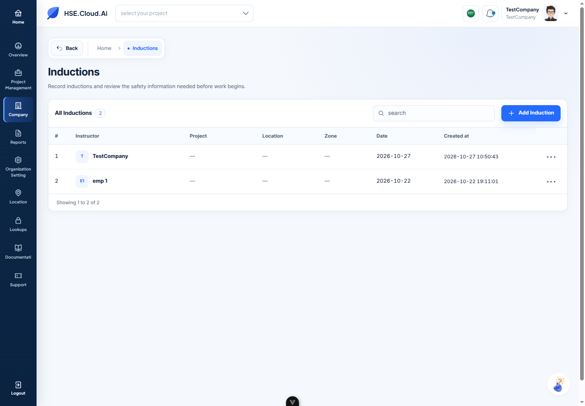
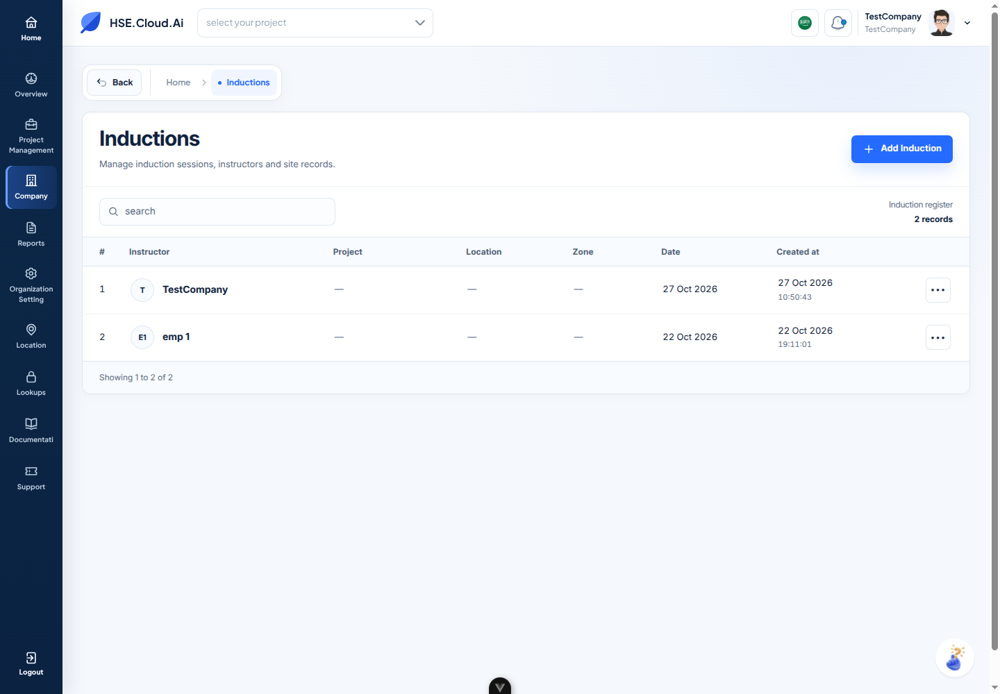
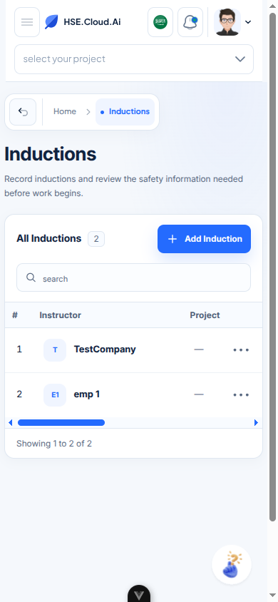
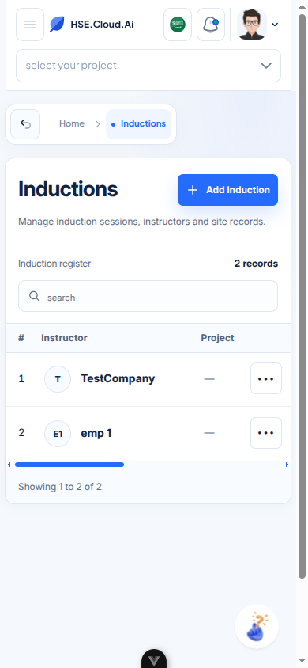

# Inductions design experiment

Status: **v6 is the active review candidate. No system-wide design approval is assumed.**

The experiment changes only Company → Inductions at `/organization/inductions`. The real route still loads the existing index component and real API data. No demo, fixture records, fabricated statistics, production deployment or remote push was introduced. The two records visible in the screenshots are the authenticated organization's API records. The original reference image was not present in the conversation; the written HSE identity direction guided the experiment.

## New alternative versus the previous design

The previous iteration separated the title from the table surface and repeated the module name in the toolbar. Date and creation timestamps had nearly the same weight as instructor names. Its 960px table also required horizontal scrolling at 1024px.

The new direction uses one continuous register surface. Its module header owns the title, descriptive subtitle and permission-gated Add action. A compact utility row aligns search with register metadata. Instructor names lead each row; the creation timestamp becomes a date with a quieter time line. Full names and location text wrap instead of being cut off after 20 characters. Missing values use a consistent em dash.

The table retains the exact original eight columns in their original order: number, instructor, project, location, zone, date, created at, actions. Widths were intentionally redistributed; the minimum width is now 880px. All columns fit at 1440px and 1024px, with internal horizontal scrolling at tablet and mobile widths. The actions column stays visible during scrolling.

Dates are formatted for the current locale without shifting the API's calendar date or timezone-free timestamp. The original value remains in the cell's title. Unknown formats fall back to their original text. This is display formatting only; request and response values are untouched.

### Screenshots: previous versus selected

| Previous v4                                             | New v6                                             |
| ------------------------------------------------------- | -------------------------------------------------- |
|  |  |
|    |    |

[Open the screenshot comparison viewer](inductions/comparison.html) to switch viewport widths. These are actual browser captures, not design mockups.

## Iterations and visual evaluation

Scores are subjective internal design assessments, not objective guarantees, functional test scores or user approval. Criterion scores use a 0–10 scale. Weighted total: hierarchy 20%, layout/spacing 20%, table readability 20%, professional appearance 15%, brand consistency 10%, responsiveness 10%, accessibility 5%.

| Iteration                           | Hierarchy | Spacing | Readability | Professional | Brand | Responsive | Accessibility | Weighted score |
| ----------------------------------- | --------: | ------: | ----------: | -----------: | ----: | ---------: | ------------: | -------------: |
| v0 — Original                       |         4 |       5 |           5 |            5 |     8 |          4 |             3 |       49.0/100 |
| v1 — First card                     |       6.5 |     6.5 |           7 |          6.5 |     8 |        5.5 |             6 |       66.2/100 |
| v2 — Controlled proportions         |         7 |       7 |         7.5 |            7 |     8 |          7 |           6.5 |       71.8/100 |
| v3 — Integrated table toolbar       |       7.5 |     7.8 |         7.5 |          7.5 |     8 |        7.8 |             7 |       76.2/100 |
| v4 — Earlier refinement, unapproved |       7.5 |     7.8 |         7.8 |          7.6 |     8 |          8 |           7.5 |       77.4/100 |
| v5 — New visual alternative         |       8.4 |     8.2 |         8.6 |          8.5 |   8.5 |        8.5 |           7.8 |       84.0/100 |
| v6 — Selected for review            |       8.6 |     8.4 |         8.8 |          8.6 |   8.7 |        8.0 |           8.3 |       85.4/100 |

- **v0:** No module header; search and table disconnected; opaque action glyph, weak mobile density.
- **v1:** Added hierarchy, instructor avatars and footer. Global CSS still oversized the mobile heading and overlapped the search icon.
- **v2:** Rebalanced columns, corrected local input rules and pinned actions. Still repeated headings and separated the title from its register.
- **v3:** Grouped search and Add; reduced mobile vertical space. Page title still floated above the panel.
- **v4:** Added local search copy, stronger focus and contrast. Composition remained too similar to a generic table card; ISO timestamps carried excessive visual weight.
- **v5:** Unified module header, toolbar, table and footer; moved Add to the module header. Human-readable dates and separate time line allow the full table to fit at laptop width.
- **v6:** Refined density, preserved 40px mobile action targets, tightened header, consolidated scoped CSS and tested behavior. This is the active candidate, awaiting user approval.

v6 is the strongest current candidate because the title/action relationship is clear, timestamps have a useful hierarchy, and the 1024px view no longer sacrifices a column to horizontal scrolling. Its restrained enterprise appearance keeps the existing navy/blue identity. Limitations remain: the live tenant supplies only two rows with missing project/location/zone data, so dense populated registers and very long values need later validation with a suitable real dataset. No artificial records were added to improve the screenshots.

### Screenshot archive

| Version | Desktop                                      | Laptop                                       | Tablet                                     | Mobile                                     |
| ------- | -------------------------------------------- | -------------------------------------------- | ------------------------------------------ | ------------------------------------------ |
| v0      | [1440px](inductions/screenshots/v0-1440.png) | [1024px](inductions/screenshots/v0-1024.png) | [768px](inductions/screenshots/v0-768.png) | [390px](inductions/screenshots/v0-390.png) |
| v1      | [1440px](inductions/screenshots/v1-1440.png) | [1024px](inductions/screenshots/v1-1024.png) | [768px](inductions/screenshots/v1-768.png) | [390px](inductions/screenshots/v1-390.png) |
| v2      | [1440px](inductions/screenshots/v2-1440.png) | [1024px](inductions/screenshots/v2-1024.png) | [768px](inductions/screenshots/v2-768.png) | [390px](inductions/screenshots/v2-390.png) |
| v3      | [1440px](inductions/screenshots/v3-1440.png) | [1024px](inductions/screenshots/v3-1024.png) | [768px](inductions/screenshots/v3-768.png) | [390px](inductions/screenshots/v3-390.png) |
| v4      | [1440px](inductions/screenshots/v4-1440.png) | [1024px](inductions/screenshots/v4-1024.png) | [768px](inductions/screenshots/v4-768.png) | [390px](inductions/screenshots/v4-390.png) |
| v5      | [1440px](inductions/screenshots/v5-1440.png) | [1024px](inductions/screenshots/v5-1024.png) | [768px](inductions/screenshots/v5-768.png) | [390px](inductions/screenshots/v5-390.png) |
| v6      | [1440px](inductions/screenshots/v6-1440.png) | [1024px](inductions/screenshots/v6-1024.png) | [768px](inductions/screenshots/v6-768.png) | [390px](inductions/screenshots/v6-390.png) |

Additional evidence:

- [Arabic mobile rendering limitation](inductions/screenshots/rtl-visual-limitation-390.png)
- [Keyboard-opened row menu](inductions/screenshots/v6-actions-390.png)
- [Pagination desktop](inductions/screenshots/v6-pagination-1440.png), [pagination mobile](inductions/screenshots/v6-pagination-390.png)
- [Search with no matches](inductions/screenshots/final-search-empty-390.png)
- [No-records presentation](inductions/screenshots/qa-empty-records-390.png)
- [Loading](inductions/screenshots/final-loading-390.png)
- [API transport error](inductions/screenshots/final-api-error-390.png)

## Scope and implementation

Application files changed:

1. [IndexInduction.vue](../../src/features/Organization/Project/Presentation/components/Induction/IndexInduction.vue): page composition, row presentation, accessible labels/keyboard activation, local English/Arabic experimental copy and display-only date helpers.
2. [inductions-register.css](../../src/features/Organization/Project/Presentation/components/Induction/inductions-register.css): page-specific typography, spacing, widths, control sizing, responsive rules and state styling. Loaded with Vue's `<style scoped src>`.

Existing APIs, controllers, models, permission arrays, routes, project query propagation, debounced search, pagination callbacks and deletion handler are retained. The original Edit action was commented out; it remains commented out. Existing translation keys are preserved. New experimental wording is component-local in English and Arabic. No shared components, global styles, sidebar, application header or other pages were modified.

No new shared UI components were created. The experiment reuses `PermissionBuilder`, `DataStatusBuilder`, `DropList`, `Pagination`, `TableLoader`, `DataEmpty` and `DataFailed`. After approval, possible extraction candidates are the unified register shell, module header, search control, sticky action cell, timestamp cell and pagination wrapper. Extracting these across the application is deliberately deferred.

The local style contract uses existing HSE identity colors and introduces only page-local sizing/density values: 40px controls, 68px rows, 30px desktop title, 24px mobile title, 14px instructor names, 13px body, 12px headers and 11px secondary time. Mobile action targets measure 40px. Small scoped `!important` overrides are necessary because legacy global responsive rules force form padding and heading sizes.

## Browser and functional verification

Chrome DevTools MCP inspected the current page, accessibility snapshots, screenshots, console messages, network request statuses and emulated viewports. Its provided connection was occupied by another Chrome instance, so review used a dedicated connection to the official Chrome DevTools MCP server and the existing authenticated review profile. CDP/Playwright supplemented DOM measurements, read-request fault injection and interaction assertions. Authentication values were neither logged nor added to artifacts.

| Check             | Result                                                                                                                                                                                                                         |
| ----------------- | ------------------------------------------------------------------------------------------------------------------------------------------------------------------------------------------------------------------------------ |
| Real table data   | Two real records rendered; eight headers and eight cells per row remain.                                                                                                                                                       |
| Search request    | Existing debounced search sends the original `word` parameter to `POST /organization/fetch_induction`.                                                                                                                         |
| Search clear      | Both search clear controls return to the normal two-record register.                                                                                                                                                           |
| No results        | Real zero-match responses render a distinct search state and working Clear search action.                                                                                                                                      |
| No records        | The same real zero-match response was presented with an empty search value for a temporary, in-memory empty-state check; the organization itself was not empty.                                                                |
| Pagination        | Temporary page size 1, through the existing handler, exercised both real records. Next shows row 2 and disables Next; Previous returns row 1. The actual page-size popover restored 10.                                        |
| Row actions       | Space/Enter open the existing popover. Show and Delete remain present for the authenticated permitted user.                                                                                                                    |
| Show              | Existing Show link reaches the original record route. Detail read requests were observed; this experiment does not modify that screen.                                                                                         |
| Add               | Existing Add link reaches `/organization/induction/add`; no form was submitted.                                                                                                                                                |
| Delete            | Existing permission/handler path preserved and menu presence checked; no record was deleted.                                                                                                                                   |
| Loading           | Held the real read request temporarily, verified the existing state transition and skeleton, then released it.                                                                                                                 |
| API error         | Deliberately aborted only the induction read request, observed the failure state, removed the interception and recovered real data. No response records were mocked.                                                           |
| RTL               | Switched through the actual language control; verified RTL direction and eight columns in the DOM, then restored English. The Arabic mobile screenshot has an unresolved shell/rendering problem; visual RTL QA is not passed. |
| Horizontal scroll | Table scrolls internally; sticky row actions remain within the viewport at both ends.                                                                                                                                          |
| Build             | Production Vite build passed. Existing large-chunk advisory remains.                                                                                                                                                           |
| Lint and format   | Targeted ESLint, Prettier and `git diff --check` passed.                                                                                                                                                                       |

[Behavior results](inductions/behavior-qa.json) and [responsive measurements](inductions/responsive-qa.json) record the checks without credentials or raw API response bodies.

### Responsive measurements

| Viewport    | Table viewport | Table width | Rows | Control height | Action target | Page-wide overflow  |
| ----------- | -------------: | ----------: | ---: | -------------: | ------------: | ------------------- |
| 1440 × 1000 |         1277px |      1277px | 68px |           40px |          36px | None                |
| 1024 × 1000 |          881px |       881px | 68px |           40px |          36px | None                |
| 768 × 1000  |          719px |       880px | 68px |           40px |          40px | None; table scrolls |
| 390 × 844   |          361px |       880px | 68px |           40px |          40px | None; table scrolls |

Mobile search uses 16px text to avoid small-input zoom behavior on mobile browsers. Responsive testing used Chrome viewport emulation, not physical iOS/Android hardware. No claim of exhaustive assistive-technology testing is made. In Arabic mobile captures, a navy shell surface covers the page even though DOM geometry and hit testing still identify the Inductions content. This reproduced with both MCP and direct CDP capture. It remains an unresolved visual issue; the correct RTL DOM measurements do not constitute a visual pass. Global sidebar/layout changes were kept outside this experiment.

### Console and network observations

The normal final induction fetch returned HTTP 200 and rendered real records. No Vue template/runtime error from the new page markup remained. The deliberately aborted API read produced `net::ERR_FAILED`, as expected for the failure-state test.

The browser console is **not completely clean**. Existing application notifications log WebSocket failures (`ExecutorSubscribableChannel`) and a push setup JSON parsing error. The push VAPID endpoint returned HTTP 200 but supplied content that the existing setup could not parse as JSON. Shared navigation also reports missing translation keys including Tools, Devices, observation report, meeting_types and ptw_types. These systems were left untouched.

A separate existing behavior was observed in search: queries for a visible instructor name, `emp`, `2026` and `9` all returned zero rows with HTTP 200; clearing the query restored two rows. This proves request/empty/recovery behavior, **not** a successful positive instructor-name search. The backend's supported search fields need confirmation. The unchanged controller can also surface an unhandled `Unable to complete the operation` rejection for empty/error responses even while the existing UI state renders. This is recorded, not silently claimed as fixed by the visual redesign.

## Version preservation and restoration

The initial Git worktree was clean. This experiment continued on the existing `styles-2` branch, without switching branches, commits, pushes or deployment. Intermediate source snapshots and screenshots preserve meaningful alternatives. The earlier design remains available despite being superseded by the selected candidate.

Source snapshots are under [inductions/versions](inductions/versions). v0–v5 contain inline styles and can be restored by copying the selected Vue snapshot over the existing index component. v6 has a separate scoped CSS file and requires both files:

```sh
cp docs/ui-redesign/inductions/versions/induction-ui-v6.vue src/features/Organization/Project/Presentation/components/Induction/IndexInduction.vue
cp docs/ui-redesign/inductions/versions/induction-ui-v6.css src/features/Organization/Project/Presentation/components/Induction/inductions-register.css
```

Restore the immediately preceding design:

```sh
cp docs/ui-redesign/inductions/versions/induction-ui-v4-final.vue src/features/Organization/Project/Presentation/components/Induction/IndexInduction.vue
```

Restore the original:

```sh
cp docs/ui-redesign/inductions/versions/induction-ui-v0.vue src/features/Organization/Project/Presentation/components/Induction/IndexInduction.vue
```

When restoring an inline-style version, the unused external CSS file can remain without affecting the page. Review subsequent local work before copying any snapshot. v6 is preserved as the strongest current visual candidate; the user has not approved adopting it elsewhere.

## Remaining review decisions

- Resolve and recheck the Arabic mobile shell/rendering issue before claiming full RTL visual support.
- Approve or reject the unified register composition and density before creating shared components.
- Confirm backend-supported search fields and the existing empty/error rejection behavior in a separate functional task.
- Validate a real tenant/register with more rows, long names, populated locations and varying permissions when available.
- Confirm the design on physical mobile devices and with keyboard/screen-reader users before broad adoption.

No additional pages will be redesigned as part of this experiment.
